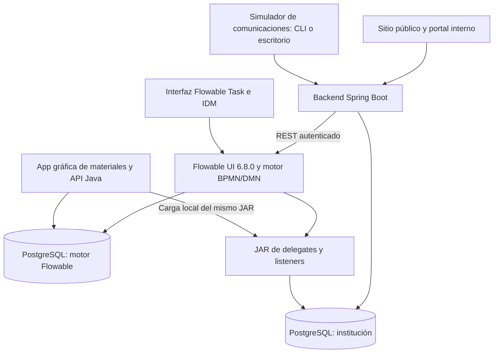
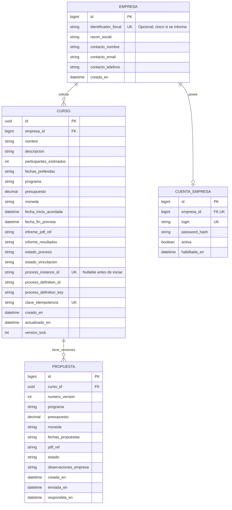
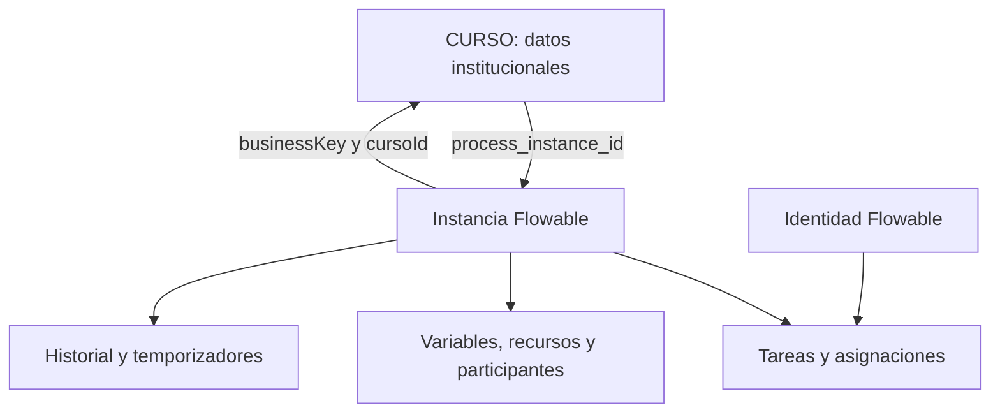
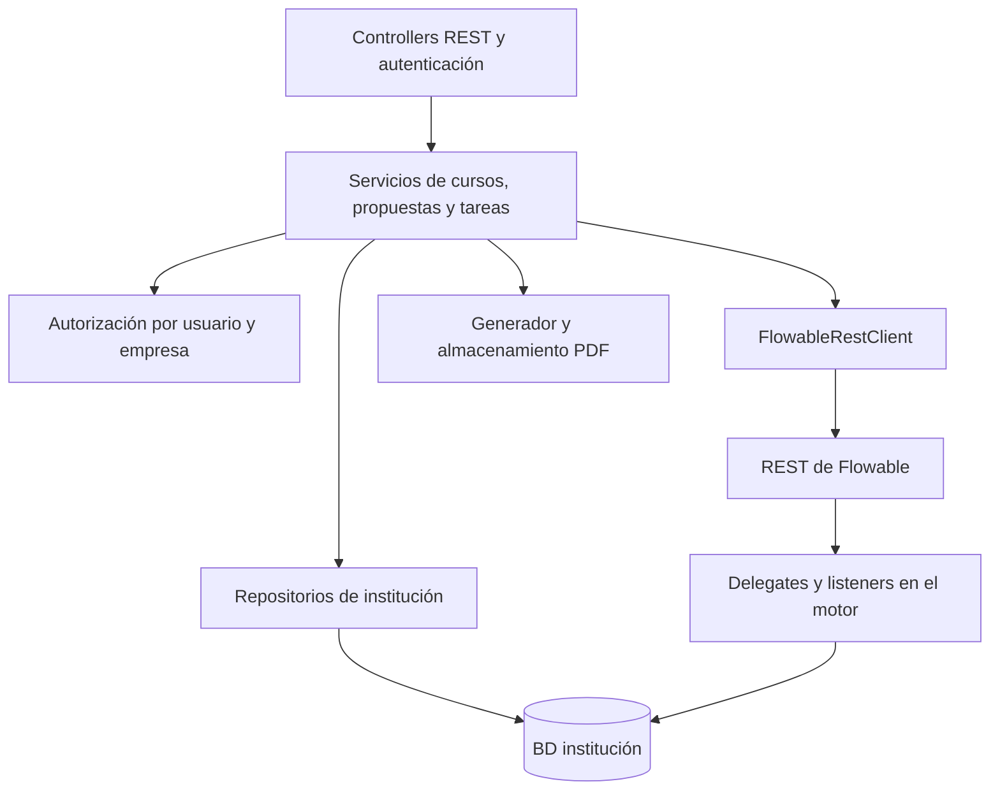
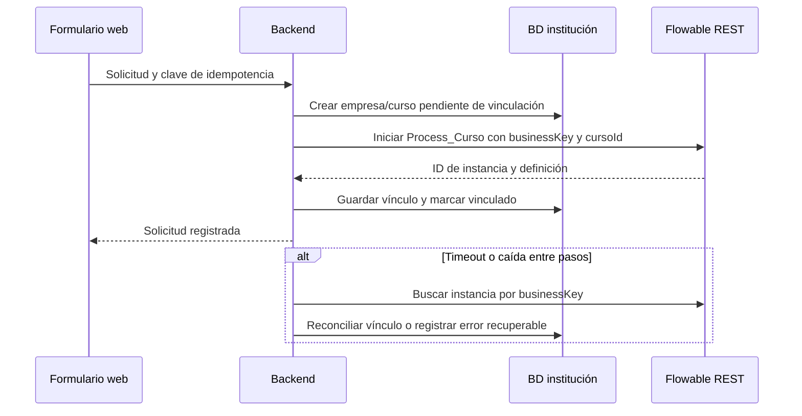
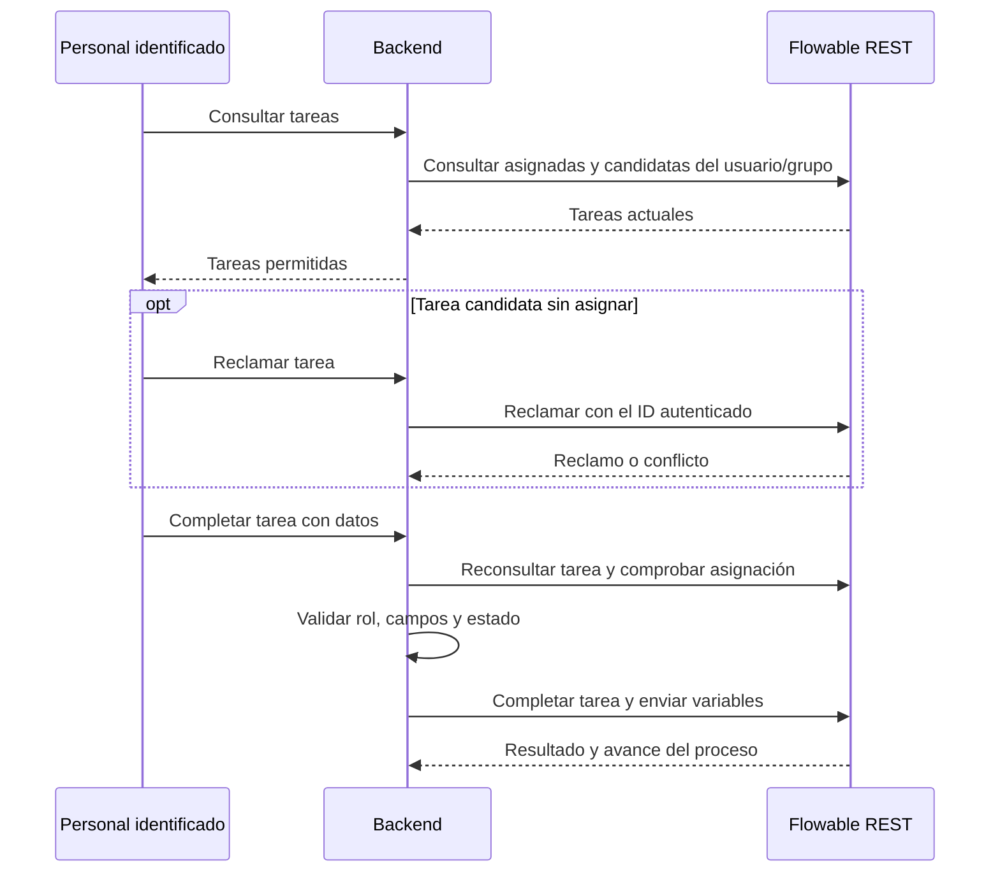
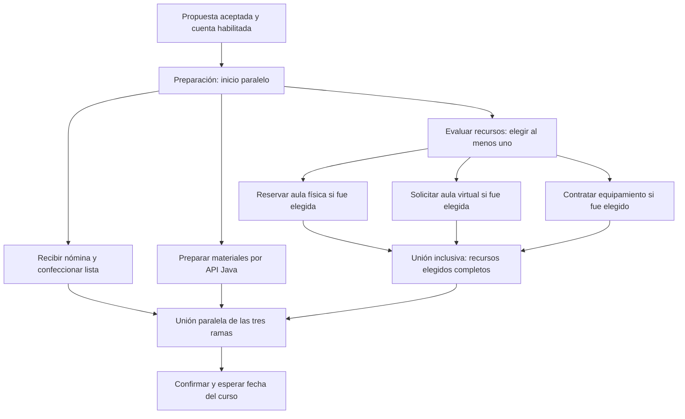
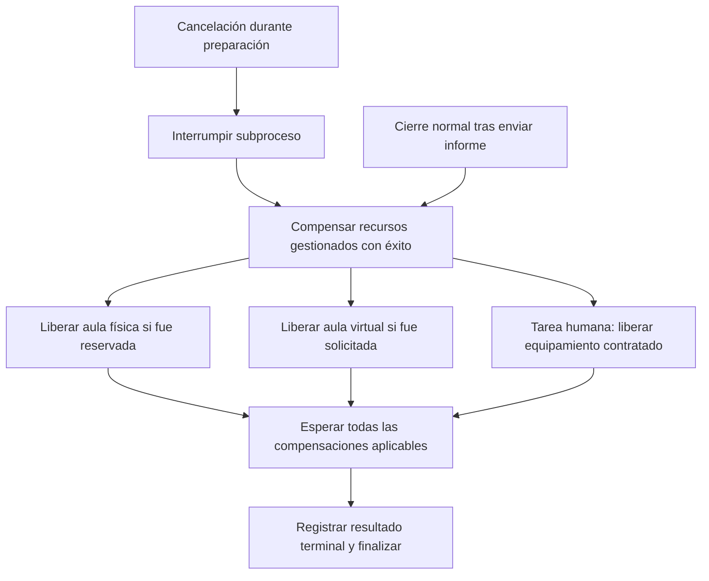
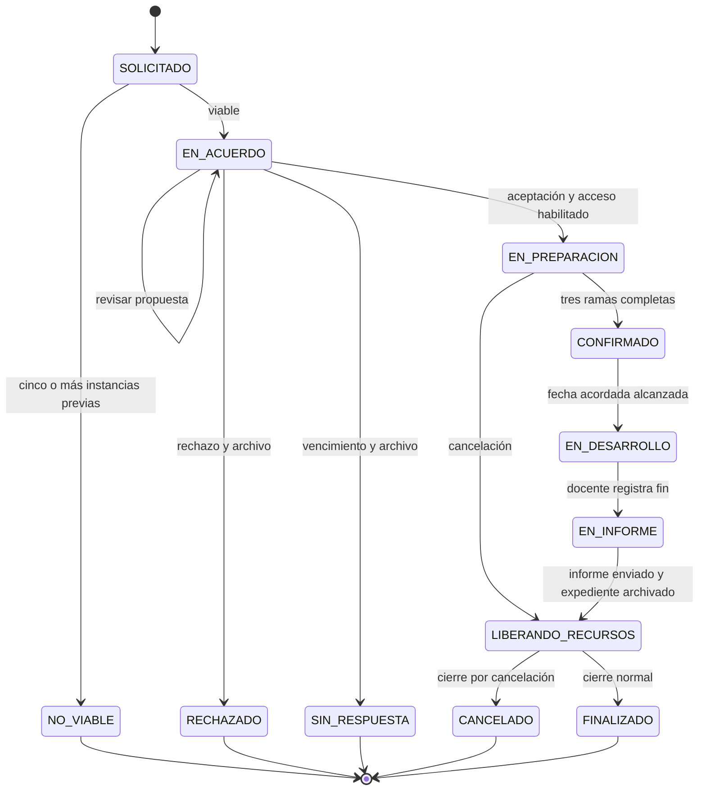

# Arquitectura y base de datos — Organización de cursos

Documento de diseño propuesto, basado en ProyectoCursos_V2.pdf, el BPMN adjunto y los ejemplos Java. No describe una implementación ya verificada: no se dispone aquí del repositorio ni de su configuración actual. Fecha: 09/11/2026.

## 1. Decisión de arquitectura

Mantener Flowable UI 6.8.0 como entorno central de ejecución, con su PostgreSQL persistente. El backend Spring Boot de la institución administra empresas, cursos, propuestas y acceso de empresas, e interactúa con el motor mediante REST. No iniciar un motor independiente con H2 en el backend: produciría instancias y tareas distintas de las visibles en Flowable UI.

La aplicación gráfica de materiales es la excepción requerida por la consigna: incorpora un motor embebido como cliente de la API Java contra la **misma base y configuración compatible** del motor central. No es un cliente Java que se conecte al objeto remoto por HTTP. Las operaciones se ejecutan en su JVM y pueden disparar listeners y continuación del BPMN; por eso también necesita las clases y dependencias de ejecución del proceso.

Se propone una base PostgreSQL `institucion` separada lógicamente de la base de Flowable. Pueden residir en el mismo servidor PostgreSQL, con usuarios y permisos propios. Los nombres son propuestos, no nombres constatados del despliegue.

Las comunicaciones del simulador pasan por el backend y este llama a REST de Flowable; así centraliza autorización y correlación. Esta es una decisión propuesta. Si la cátedra exige acceso directo del simulador a REST de Flowable, puede sustituirse ese salto manteniendo las mismas validaciones.

## 2. Modelo relacional de la institución

El mínimo obligatorio es empresa y curso, con los datos de la solicitud y el vínculo a la instancia. Se agregan cuenta de empresa y versiones de propuestas para satisfacer el portal y conservar cada PDF emitido. No crear cuentas locales para los cinco empleados: se autentican con Flowable.

### Restricciones y significado de los campos

| Elemento | Regla propuesta |
|---|---|
| Empresa → curso | Una empresa puede tener muchos cursos; cada curso pertenece a una empresa. |
| Cuenta de empresa | Cero o una cuenta por empresa; se crea o reutiliza al aceptar la propuesta, antes de preparar. |
| Identificación de empresa | No deduplicar por nombre o email de contacto solamente. Usar identificador fiscal cuando exista; si falta, resolver identidad antes de reutilizar una cuenta. |
| Datos de solicitud | Nombre, descripción, participantes estimados y fechas preferidas se guardan antes de iniciar el proceso. |
| Campos acordados | Programa, presupuesto y fecha acordada pueden ser nulos inicialmente; son obligatorios antes de preparar el curso. |
| Presupuesto | `NUMERIC(14,2)`, no flotante; importe no negativo y moneda explícita. |
| Fechas | PostgreSQL `TIMESTAMPTZ` para instantes; acordar zona horaria al cargar la fecha y convertir explícitamente al valor del timer. |
| Propuesta | `UNIQUE(curso_id, numero_version)`; preservar las versiones enviadas y sus PDF. |
| Propuesta aceptada | Una sola versión aceptada por curso; exigirla antes de preparar. Puede implementarse con índice único parcial. |
| Relación con Flowable | `process_instance_id` es una referencia lógica externa, no una FK SQL a tablas `ACT_*`. Única cuando tenga valor. |
| Correlación inversa | `businessKey = curso.id` como texto; variable `cursoId` con el mismo valor. |
| Versiones del proceso | Guardar el `process_definition_id` exacto y la clave estable `Process_Curso`. |
| Idempotencia | Clave única por envío de formulario; el servidor valida que un reintento tenga el mismo contenido. |
| Concurrencia | `version_lock` permite bloqueo optimista en la aplicación; no reemplaza las reglas de concurrencia del motor. |
| PDF | `pdf_ref` e `informe_pdf_ref` referencian almacenamiento persistente accesible al backend. No usar rutas temporales del equipo del usuario. |
| Credenciales | Guardar únicamente hash de la contraseña de empresa; las contraseñas del personal no se copian a estas tablas. |

`CURSO.programa`, presupuesto y fecha acordada constituyen la versión vigente para consulta. `PROPUESTA` conserva los valores históricos. Al aceptar, copiar los valores de esa versión al curso en una operación consistente. El estado del curso es una proyección de consulta: Flowable decide qué actividad está habilitada.

Participantes, selección de recursos y reservas pueden mantenerse como variables del proceso, tal como permite la consigna. No se necesitan tablas propias de tareas, empleados, grupos o temporizadores. Si luego se requieren reportes de participantes o reservas fuera del motor, incorporar tablas específicas y definir qué sistema será su fuente de verdad.

## 3. Separación de datos y vínculo con el motor

No escribir SQL sobre las tablas internas del motor para reclamar, completar, asignar o cancelar. Usar REST o API Java. La conexión JDBC de materiales existe para que **el motor embebido** realice sus operaciones, no para manipular esas tablas manualmente.

## 4. Componentes del backend y del JAR

Distribución sugerida: `backend/`, `frontend/`, `app-materiales/`, `simulador-comunicaciones/`, `flowable-extensions/`, `database/`, `infra/` y `docs/`. Es una propuesta para organizar el trabajo, no una estructura encontrada en el repositorio.

El JAR debe incluir el listener de asignación, el listener de cierre y los delegates requeridos: conteo de instancias, habilitación de cuenta, reserva/liberación simulada y notificaciones. El BPMN y la decisión DMN deben desplegarse en el entorno que ejecuta las instancias. No basta con tener clases en el backend Spring Boot.

## 5. Alta de una solicitud y manejo de fallos

La creación del curso y la llamada REST no forman una única transacción. Propuesta de `estado_vinculacion`: `PENDIENTE`, `VINCULADO`, `ERROR`. Antes de reintentar el inicio, buscar por `businessKey`; no asumir que esta clave es única por imposición de Flowable. Serializar los intentos del mismo curso en el backend y reconciliar los casos inciertos. No borrar el curso ante un timeout: el motor puede haber iniciado la instancia.

El curso debe existir antes de invocar el inicio: una instancia no viable puede finalizar y ejecutar el listener de cierre dentro de esa misma llamada. Ese listener debe actualizar por `cursoId`/businessKey, incluso si aún no se guardó `process_instance_id`. La respuesta del inicio no debe sobrescribir un estado terminal ya registrado.

## 6. Tareas, reclamo y autorización

No confiar en `usuarioId`, `empresaId`, `assignee` o grupo enviados por el navegador. Derivarlos de la sesión validada. El backend comprueba pertenencia, asignación y permisos; disponer del privilegio REST no equivale a autorización de negocio. Tratar conflictos de reclamo o tareas ya finalizadas como conflictos recuperables y refrescar la pantalla.

| Usuario/grupo propuesto | Cantidad | Responsabilidades |
|---|---:|---|
| `administracion` | 2 | Materiales, recursos, aula virtual, equipamiento y liberación de equipamiento. |
| `jefeAdmin` incluido en Administración | 1 de los 2 | Proponer, enviar, revisar, archivar y enviar informe final. |
| `docentes` | 3 | Ser elegibles para desarrollar un curso. |
| `jefeDocente` incluido en Docentes | 1 de los 3 | Seleccionar docente y elaborar informe. |

Los IDs anteriores son convenciones propuestas: usar exactamente los mismos valores en IDM, BPMN y código. `Lista` se asigna directamente mediante listener al administrativo con menos tareas pendientes asignadas; no cuenta tareas solo candidatas. Desempate propuesto: ID ascendente. Si no hay integrantes, producir un error explícito de configuración.

## 7. Preparación paralela y compensaciones

La vista de empresa debe consultar actividades activas, no asumir una sola tarea actual. Usar tareas más ejecuciones/actividades del motor para incluir esperas de mensajes y ramas automáticas; mostrar una lista de actividades durante la preparación.

Este diagrama expresa la semántica requerida; no reemplaza el BPMN ejecutable. La selección de un recurso no acredita que se haya gestionado: la compensación corresponde únicamente a actividades completadas correctamente. No registrar `FINALIZADO` o `CANCELADO` antes de terminar sus liberaciones. Hacer las liberaciones idempotentes por identificador de reserva. La falta de aula debe lanzar el error BPMN previsto y seguir la ruta definida en el modelo, no producir una confirmación falsa.

## 8. Estados de consulta del curso

Estos estados son una propuesta de proyección para la aplicación. `resultadoProceso` distingue los cinco resultados terminales. El Execution Listener de fin registra el resultado en la institución. Para los estados intermedios, derivar la información del motor o agregar puntos explícitos de actualización; un listener de fin por sí solo no los mantiene.

En el portal, `CONFIRMADO` se muestra como “Confirmado y pendiente de inicio”. Durante liberación, mostrar “Cierre en curso”. La cuenta de empresa solo accede a cursos cuyo `empresa_id` coincida con el de su sesión, incluyendo el acceso a PDF.

## 9. Variables de integración propuestas

| Variable | Tipo lógico | Uso |
|---|---|---|
| `cursoId` | String UUID | Vínculo inmutable con la institución. |
| `cantidadOtrasInstancias` | Entero | Calculado por el motor, excluye la propia instancia y abarca versiones de `Process_Curso`. |
| `viable` | Boolean | Resultado de decisión DMN: cantidad menor que cinco. |
| `propuestaVersion` | Entero | Versión enviada; coincide con el registro institucional. |
| `respuestaEmpresa` | String | `ACEPTAR`, `RECHAZAR` o `MODIFICAR`. |
| `observacionesEmpresa` | String | Cambios solicitados. |
| `recordatoriosEnviados` | Entero | Inicialmente 0; reiniciar con cada nueva versión enviada; máximo 2. |
| `fechaInicioCurso` | Fecha compatible con el timer | Establecida al aceptar, antes de llegar al temporizador. |
| `participantes` | JSON compatible | Nómina y lista definitiva; sin validación individual obligatoria. |
| `requiereAulaFisica`, `requiereAulaVirtual`, `requiereEquipamiento` | Boolean | Activan una o varias ramas; al menos una verdadera. |
| `aulaReservaId`, `aulaVirtualId`, `equipamientoContratoId` | String | Identificadores para seguimiento y liberación. |
| `docenteSeleccionado` | String | ID Flowable de uno de los tres docentes; assignee de `Dictar`. |
| `informePdfRef` | String | Referencia persistente y protegida al informe. |
| `resultadoProceso` | String | `FINALIZADO`, `CANCELADO`, `RECHAZADO`, `SIN_RESPUESTA`, `NO_VIABLE`. |

Usar serialización compatible entre todos los runtimes; evitar objetos Java de clases exclusivas de una aplicación. Los nombres se deberán enlazar explícitamente con expresiones, condiciones y formularios del BPMN.

La DMN usa el número de **otras instancias no finalizadas**, también las que están en acuerdo o preparación, no solo los cursos que se están dictando. La consulta por clave de proceso debe abarcar las versiones desplegadas. Si se busca un límite estricto con solicitudes simultáneas, serializar la admisión: contar y evaluar por separado puede producir carreras.

## 10. Conexiones y despliegue local

| Componente | Destino | Configuración necesaria |
|---|---|---|
| Backend | REST Flowable | Base local de ejemplo `http://localhost:8080/flowable-ui/process-api`; desde Docker usar el nombre del servicio y puerto interno. |
| Login del personal | IDM Flowable | Ejemplo docente: `/flowable-ui/api/idm/users/{id}` con Basic Auth del mismo usuario; distinguir 200, 401 y 403. |
| Backend y JAR | BD institución | JDBC, usuario y contraseña externos al repositorio. |
| Flowable UI | BD motor | PostgreSQL persistente; conservar los volúmenes. |
| App materiales | BD motor | Misma base, esquema y versión Flowable; usuario JDBC autorizado, sin crear otra base H2. |
| Navegador | Backend | Sesión de aplicación; credenciales técnicas de Flowable no expuestas. |
| JAR en Docker | Classpath del motor | Empaquetar en imagen personalizada para sobrevivir a recreaciones. |

En el motor embebido de materiales, desactivar la creación/actualización automática del esquema y el executor asíncrono; dejar timers y jobs al runtime central. Incluir configuración compatible de motores auxiliares, historial, beans, listeners y serializadores: compartir JDBC solamente no garantiza una ejecución compatible. Cada continuación síncrona ocurre en el runtime que completa la tarea y debe encontrar todas las clases necesarias.

El executor asíncrono central debe estar habilitado para que se ejecuten los temporizadores. Validar la versión de Spring Boot del backend antes de agregar dependencias Flowable 6.8.0; esta arquitectura REST evita que el backend tenga que alojar el motor. La compatibilidad de los ejemplos y del JAR con Java 21 debe probarse en el contenedor real; no se deduce de la versión del Java instalado en la PC.

El listener de cierre escribe en otra base: no existe atomicidad automática entre ambas. Para el MVP, hacer la actualización idempotente por `cursoId`, permitir que el fallo se propague y definir reintento/reconciliación. No capturar y silenciar errores. No anunciar cierre exitoso si el motor revirtió la operación. Para una versión robusta, diseñar entrega durable de eventos y reconciliación; no prometer transacción distribuida por usar Spring.

## 11. Contrato REST propio sugerido

Estas rutas son propuestas del backend; no son endpoints nativos de Flowable.

| Método y ruta | Operación |
|---|---|
| `POST /api/solicitudes` | Registrar solicitud e iniciar/reconciliar instancia. |
| `POST /api/sesiones/personal` | Validar credenciales Flowable y crear sesión. |
| `POST /api/sesiones/empresa` | Validar cuenta institucional. |
| `GET /api/empresa/cursos` | Cursos de la empresa autenticada. |
| `GET /api/empresa/cursos/{id}/seguimiento` | Estado y actividades simultáneas autorizadas. |
| `GET /api/tareas` | Asignadas y candidatas del usuario. |
| `POST /api/tareas/{id}/reclamo` | Reclamar como usuario de sesión. |
| `POST /api/tareas/{id}/completar` | Validar formulario y completar. |
| `POST /api/cursos/{id}/comunicaciones` | Simular respuesta, nómina o cancelación habilitada. |
| `GET /api/cursos/{id}/documentos/{documentoId}` | Descargar PDF previa autorización. |

Las comunicaciones deben correlacionarse con la suscripción activa de esa instancia; no emitir señales globales que afecten otros cursos. Los IDs y nombres de mensajes deben extraerse del BPMN final. Si la empresa responde a una propuesta, incluir su versión para rechazar respuestas antiguas. Una cancelación fuera de preparación debe rechazarse.

## 12. Ajustes detectados en los archivos adjuntos

1. El BPMN adjunto identifica el proceso como `Process_Curso` y declara `isExecutable="false"`. Convertirlo en ejecutable y completar expresiones, mensajes, timers, DMN, listeners y delegates antes de desplegar.
2. `AsignarTarea` utiliza `GRUPO_ALUMNOS = "alumnos"`. Sustituirlo por el ID real de Administración. La lista vacía actualmente deja la asignación en nulo: tratarla como error de configuración.
3. El ejemplo de asignación usa APIs internas `CommandContextUtil`. Preferir servicios inyectados/configurados cuando sea viable y probar cualquier uso interno contra la versión exacta 6.8.0.
4. El ejemplo de autenticación usa la ruta IDM indicada por el material docente. Confirmar su disponibilidad y el privilegio `access-rest-api` de los cinco usuarios en el contenedor real.
5. La consigna menciona selección docente mediante aplicación móvil en una sección y sitio web en la sección de funciones. Propuesta: sitio adaptable a móvil; no se asume una cuarta aplicación nativa obligatoria.
6. No marcar un fin de compensación como cierre exitoso hasta completar todos sus handlers. Verificar especialmente la compensación de aula virtual y las rutas de cancelación en el BPMN ejecutable.

## 13. Orden de implementación y validación

1. Crear migraciones y datos de prueba de institución; configurar los cinco usuarios y dos grupos en Flowable.
2. Empaquetar la imagen personalizada con el JAR; desplegar BPMN ejecutable y DMN.
3. Implementar registro de solicitud con correlación y recuperación de fallos.
4. Implementar autenticación, tareas, propuestas versionadas y PDF.
5. Implementar simulador REST; para este grupo de tres la consigna permite CLI.
6. Implementar materiales con interfaz gráfica y API Java sobre la base compartida.
7. Implementar cuenta de empresa, consulta exclusiva y seguimiento paralelo.
8. Validar los once escenarios de defensa de la consigna, además de reinicio de contenedores, reintentos del formulario, doble reclamo y fallo de sincronización del cierre.

Prueba de integración clave: crear un curso desde la web, localizar su instancia en Flowable UI, completar Materiales desde la app Java y verificar que desaparece la misma tarea en la web y en Flowable Task. Si cada aplicación muestra instancias distintas, revisar JDBC, esquema, definición y entorno antes de seguir.

## 14. Fuentes y alcance

- `ProyectoCursos_V2.pdf`: requisitos de datos, identidades, listeners, aplicaciones y demostración.
- `Proyecto_Organizacion_cursos.bpmn`: IDs y estructura del modelo adjunto.
- `SolucionesVarias_168428749935.pdf`: JAR en el motor, autenticación y privilegio REST.
- Ejemplos Java y `verciones.txt`: referencias provistas; no prueban el estado actual del repositorio.
- [API Java de Flowable OSS](https://www.flowable.com/open-source/docs/bpmn/ch04-API): servicios del motor.
- [Configuración de Flowable OSS](https://www.flowable.com/open-source/docs/bpmn/ch03-Configuration): configuración del motor y jobs.

Los diagramas y contratos de este documento son una propuesta de implementación fundada en la consigna. No se generaron scripts SQL ni se modificó el BPMN, el código o el despliegue.
