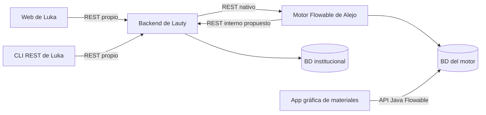

# Acuerdo inicial de integración

Proyecto universitario **Gestión y Tecnologías de Procesos de Negocio**. Equipo: **Alejo, Lauty y Luka**.

**Actualización de infraestructura (2026-11-09):** a pedido del usuario,
Compose incorpora el servicio `backend`, construido desde `backend/Dockerfile`
con Java 21 y publicado en `127.0.0.1:8081`. Comparte `flowable-net` y la política
`restart: unless-stopped` de Flowable. El backend aún es independiente del motor
y de PostgreSQL; este cambio solo incorpora su compilación y arranque con
`docker compose up`. Las menciones siguientes a no modificar Compose describen
el alcance del acuerdo documental inicial. Los pasos actuales están en el README.

Este documento permite preparar cambios en paralelo; no acredita funcionalidades ejecutadas. Todas las rutas, variables, cuentas y modelos de datos propuestos requieren implementación posterior. No se incorporan lógica, dependencias ni cambios de infraestructura con este acuerdo.

## Base revisada y forma de leer el acuerdo

| Marca | Significado |
|---|---|
| **E** | Existente y verificado por inspección de archivos; no implica ejecución comprobada. |
| **C** | Convención inicial propuesta para trabajar; no es un requisito nuevo de la consigna ni una implementación existente. |
| **P** | Pendiente de validar técnicamente o entre responsables; se propone una opción concreta en M. |

Salvo que se indique **E**, las tablas de contratos son **C**. Las decisiones **P** deben resolverse antes de integrar el comportamiento afectado.

Fuente principal: [ProyectoCursos_V2.pdf](../contexto/ProyectoCursos_V2.pdf), §§1–5. También se inspeccionaron [README](../README.md), [.gitignore](../.gitignore), [Compose](../docker-compose.yml), [pom.xml](../backend/pom.xml), las clases Java y [application.properties](../backend/src/main/resources/application.properties). No se encontraron `AGENTS.md` aplicables en los ancestros ni dentro del proyecto. Los ejemplos Java externos y «Soluciones varias» no están disponibles; sí existe `unrc.Main`.

Base local: `main`, commit `2c973426c8499be67b58e7e635db44169aa1af89`, sin cambios rastreados al comenzar. La consulta remota de la planificación anterior confirmó el mismo commit; este trabajo no hizo fetch ni supone que GitHub siga sin cambios. No se ejecutaron Maven, Docker, aplicaciones ni modelos.

| Material **E** | Observación | Uso acordado **C/P** |
|---|---|---|
| [BPMN conceptual](../contexto/Proyecto_Organizacion_cursos.bpmn) | Proceso `Process_Curso`, `isExecutable=false`; contiene IDs legibles, `recordatorios`, `fechaCurso` y condiciones de recursos. | Reutilizar sus identificadores para la futura implementación; no desplegarlo sin completarlo. |
| [Borrador versión 2](../contexto/Proyecto_Gestion_y_Tecnolog%C2%B4%C4%B1as_de_Procesos_de_Negocio_version_2.bpmn20.xml) | Proceso `process`, `isExecutable=true`; preparación vacía, IDs `sid-…` y configuración incompleta. | Referencia adicional; la marca ejecutable no prueba cumplimiento. Alejo valida elección del modelo base. |
| [Código de backend](../backend/src/main/java/ar/edu/cursos/EstadoController.java) | Solo se observa `GET /api/estado` y arranque Spring Boot. | Los endpoints de F aún no existen. |
| [Prueba unrc.Main](../backend/src/main/java/unrc/Main.java) | Motor H2 efímero independiente, sin despliegue del BPMN institucional. | Conservarla; no usarla como instancia compartida. |

La consigna prevalece sobre documentación residual de encuestas o correcciones individuales en el modelo conceptual: no se incorporan esos requisitos (§1.2). No mover ni alterar ahora los BPMN de referencia. El futuro archivo ejecutable se ubicará en `motor-flowable/`, con nombre y método de despliegue por validar; esta carpeta no implica otro motor.

## A. Responsables y límites

| Componente y ruta real | Responsable | Límite y coordinación |
|---|---|---|
| [motor-flowable/](../motor-flowable/) | Alejo | BPMN ejecutable, DMN de viabilidad, cinco usuarios/grupos, asignaciones, mensajes, jobs, listeners, cancelaciones y compensación. Publica IDs y contratos del motor. |
| [backend/](../backend/) | Lauty | Equivale a `backend-institucion/`; conservar nombre y código. BD institucional, empresas/cursos, vínculo con instancias, cuentas de empresa, estados consultables, API propia y PDFs. |
| [web/](../web/) | Luka | Formularios y vistas; consume API propia, no accede a BD ni fija reglas de autorización solo en UI. |
| [app-materiales/](../app-materiales/) | Luka | Interfaz gráfica intranet con API Java de Flowable; coordina runtime/BD/componentes con Alejo. |
| [simulador-rest/](../simulador-rest/) | Luka | CLI permitida por ser tres integrantes; consume REST para las cinco comunicaciones. |
| [docs/](./) | Los tres | Contrato compartido, decisiones, ejemplos y evidencia. Cada responsable actualiza su parte. |
| [contexto/](../contexto/) | Referencias comunes | Consigna y modelos existentes; no confundir con el entregable ejecutable futuro. |

Compartidos: este acuerdo, README principal, raíz de paquetes Java, IDs y variables BPMN, formato de mensajes/REST, esquema de datos institucional, `pom.xml` de cada componente futuro, configuración de conexión e infraestructura existente. Alejo mantiene BPMN/DMN e interfaz del motor; Lauty mantiene esquema SQL y contratos REST propios; Luka verifica que puedan consumirlos sus tres interfaces. Cambios de Compose, versiones o puertos requieren coordinación de los tres, no una modificación unilateral para hacer funcionar una rama.

Antes de cambiar un contrato: describir impacto en issue/PR, acordar con productor y consumidores, actualizar tablas y ejemplos en el mismo PR y documentar migración/compatibilidad. Un cambio de ID, variable, tipo, estado o ruta no se integra silenciosamente.

## B. Arquitectura y comunicación



**C:** web y CLI usan el backend como fachada; este valida permisos y traduce al REST del motor. Así se satisface la interacción REST (§§4.1 y 4.2.2) sin duplicar reglas ni exponer una cuenta técnica al navegador. La CLI sigue siendo REST aunque no conozca `executionId`. Alejo implementa los componentes incorporados al motor que invocan habilitación de empresa y cierre en el backend.

La app de materiales usa `IdentityService`/mecanismo de identidad acordado y `TaskService` de la API Java, con verificación de permisos propia y guardas del motor. Nunca sustituirla por REST. Necesitará un contexto de motor para acceder por Java al mismo esquema persistente; **P:** acordar con Alejo su configuración, disponibilidad de delegates/listeners/DMN al completar `Material`, ejecutor de jobs y compatibilidad de librerías. No ejecutar H2 ni crear una BD o despliegue aislado. Una llamada `complete` puede continuar el proceso: ese contexto también debe resolver los componentes que lleguen a ejecutarse.

Todos comparten `processInstanceId`, `taskId` y `cursoId`; la aplicación Java no crea solicitudes ni redespliega el BPMN. Consultar por la misma clave estable y por IDs devueltos por el motor. No usar IDs inventados ni seleccionar una instancia «más reciente» como correlación.

**E:** Compose define un PostgreSQL para el motor y Flowable UI 6.8.0; el backend solo tiene puerto/arranque y dependencias. **P:** confirmar dónde y con qué autenticación se expone realmente REST, DMN y la identidad de UI en esta distribución. La URL de UI no demuestra disponibilidad del REST independiente.

La BD institucional será propia y separada de las tablas internas de Flowable (§3.2). **C:** base lógica distinta, aunque pueda compartir servidor PostgreSQL; conexión y aprovisionamiento por acordar, sin editar Compose ahora. Solo Flowable administra su esquema. El backend no modifica `ACT_*`; la app Java usa servicios del motor, nunca SQL directo para reclamar/completar.

## C. Convenciones e identificadores

### Carpetas, Java y proceso

| Elemento | Convención **C** / evidencia **E** |
|---|---|
| Carpetas | Las rutas reales de A; no crear `backend-institucion/` ni duplicar `backend/`. |
| Java | Mantener `ar.edu.cursos` (**E**). Proponer subpaquetes `ar.edu.cursos.institucion`, `ar.edu.cursos.motor`, `ar.edu.cursos.materiales`; clases `PascalCase`, métodos/variables `camelCase`. No mover clases actuales. |
| Proceso | Clave propuesta `Process_Curso`, reutilizada del conceptual. El borrador tiene `process`: no tratar ambas como versiones de la misma clave. Confirmar si existe algún despliegue real antes de consolidar (**P1**). |
| Versiones | Mantener clave e IDs semánticos en redeploys; nuevas versiones de la misma clave. No filtrar viabilidad por un solo `processDefinitionId`. |
| IDs de negocio | `cursoId` y `empresaId`: UUID representados como cadenas; ejemplos ficticios. |
| Correlación | `businessKey = curso:<cursoId>`; backend conserva `processInstanceId` único. `taskId` y `executionId` son opacos y los genera Flowable. |
| Documentos | `propuestaId` e `informeId`: referencias opacas institucionales; no rutas locales ni URLs públicas permanentes. |

No regenerar IDs al editar diagramas. UI/CLI usan `taskDefinitionKey` para reconocer una actividad y `taskId` para operar una tarea concreta. Conservar nombres visibles legibles sin usarlos como claves de código.

### IDs de actividades relevantes

Los IDs siguientes **existen en el conceptual**; su utilización en el modelo ejecutable es **C/P1**. No se afirma que ya tengan asignaciones o código funcional. El borrador versión 2 usa otros IDs; no mezclar clientes contra ambos modelos.

| ID canónico propuesto | Actividad | Ajuste requerido para implementación |
|---|---|---|
| `Inicio` | Solicitud recibida | Inicio por REST por clave; decidir conservar mensaje de inicio sin duplicar arranques. |
| `Activity_1xw400l` | Evaluar viabilidad | Decision task con DMN y conteo desde motor. |
| `Propuesta` | Registrar y elaborar propuesta | Jefe administrativo; formulario/PDF institucional. |
| `Enviar` | Enviar propuesta | En conceptual es script; §2 exige responsabilidad del jefe: convertir a tarea humana conservando ID y automatizar transporte después. |
| `Revisar` | Revisar propuesta | Jefe administrativo; nueva versión. |
| `Archivar` | Archivar solicitud | Jefe administrativo; rechazo o falta de respuesta. |
| `Aceptar`, `Rechazar`, `Modificar`, `Plazo` | Esperas de negociación | Correlación por versión y timers. |
| `Activity_1eg7zcl` | Habilitar acceso de empresa | Automática tras aceptar y antes de `Preparar`. |
| `Preparar` | Subproceso de preparación | Tres ramas paralelas sin dependencia entre ellas. |
| `Nomina` | Recibir nómina | Actualmente receive task sin contrato de mensaje; enlazar mensaje o convertir a catch event conservando ID (**P1**). |
| `Lista` | Confeccionar lista definitiva | Task Listener `create`, asignación al administrativo con menor carga. |
| `Material` | Preparar materiales | Grupo candidato `administracion`; app gráfica Java. |
| `Activity_12i2hpf` | Evaluar recursos | Grupo candidato `administracion`; al menos una alternativa. |
| `Aula`, `Virtual`, `Equipo` | Gestionar aula física, virtual y equipamiento | Aula automática; otras humanas de Administración. |
| `Activity_16zz91p`, `Activity_02hrooc`, `Activity_1m08pcl` | Liberar aula física, virtual, equipamiento | Primeras dos automáticas; equipamiento humana de Administración. |
| `Activity_048d5em`, `Event_1g4xmqo` | Cancelación / recepción | Mensaje interruptivo solo dentro de preparación; enlazar `Msg_cancel`. |
| `Confirmar` | Confirmación de curso | Automática después de terminar las tres ramas. |
| `Activity_1018bdz` | Definir docente | Jefe docente; elegir uno de tres. |
| `Fecha` | Esperar inicio acordado | `timeDate` usa `fechaCurso`, ya referenciada en conceptual. |
| `Dictar` | Desarrollar curso | Asignación directa a `docenteId`. |
| `Informe` | Elaborar informe de resultados | Jefe docente; PDF por UI Flowable o web opcional. |
| `EnviarInforme` | Enviar informe y archivar expediente | Jefe administrativo; después liberar recursos antes del fin real. |

### Identidades de prueba de la institución

No se encontraron IDs de personal configurados en los archivos inspeccionados. Estos son **C**, no cuentas creadas ni las identidades de Alejo, Lauty y Luka.

| ID de usuario | Nombre ficticio / función | Grupo ID | Asignación exclusiva |
|---|---|---|---|
| `admin_jefe` | Jefatura administrativa | `administracion` | Jefe administrativo |
| `admin_01` | Administración auxiliar | `administracion` | Ninguna jefatura |
| `docente_jefe` | Jefatura docente | `docentes` | Jefe del equipo docente |
| `docente_01` | Docente uno | `docentes` | Puede ser seleccionado para dictado |
| `docente_02` | Docente dos | `docentes` | Puede ser seleccionado para dictado |

Grupos: ID `administracion`, etiqueta **Administración**; ID `docentes`, etiqueta **Docentes**. Son dos y tres integrantes respectivamente; los jefes ya están incluidos. No existe una cuenta por desarrollador como requisito del proceso. Cualquier identidad técnica de integración se acuerda aparte y no se cuenta como empleado. No fijar contraseñas aquí.

## D. Diccionario de variables del proceso

**C:** tipos Flowable explícitos `string`, `integer`, `boolean`. Las estructuras JSON se exponen como objetos/listas en la API propia, pero se serializan como texto JSON en una variable `string` al cruzar REST/Java, hasta acordar otro formato. No usar serialización de clases Java entre componentes. Todas las variables de proceso de esta tabla tienen alcance de instancia, no task-local; validaciones en backend y motor según autoría.

Leyenda de persistencia: **M** = BD del motor mediante API Flowable; **I** = BD/almacenamiento institucional; **D** = derivado al consultar, sin segunda escritura persistida. Las referencias en M a datos I son enlaces o snapshots operativos justificados, no una segunda fuente editable.

| Nombre exacto | Tipo | Significado / validaciones | Escribe → lee | Cuándo debe existir | Persistencia / fuente |
|---|---|---|---|---|---|
| `cursoId` | string UUID | Identificador de curso existente. Inmutable. | Backend al iniciar → todos los componentes | Antes de evaluar viabilidad | I como PK; referencia M. |
| `empresaId` | No es variable M | Se resuelve desde el curso; no confiar en ID enviado por empresa. | Backend → consultas autorizadas | Alta de solicitud | I; no duplicar en M por defecto. |
| `processInstanceId` | ID nativo / string en I | Vínculo único con curso; no generar manualmente. | Motor genera, backend vincula → todos | Inicio/callback temprano | M nativo + FK lógica única I; no variable homónima. |
| `propuestaId` | string | Referencia a snapshot inmutable con programa, presupuesto, fechas posibles y PDF. Debe corresponder al curso. | Backend al elaborar/revisar → tareas, mensajes | Antes de enviar propuesta | Fuente I, enlace M. |
| `propuestaVersion` | integer ≥1 | Versión monotónica. Cambia al crear nueva propuesta; respuestas deben coincidir con versión enviada. | Backend fija versión, motor la recibe en tarea → esperas/CLI | Elaboración y cada revisión | I única por curso/versión; snapshot M para correlación. |
| `respuestaEmpresa` | string enum | `ACEPTADA`, `RECHAZADA`, `MODIFICACIONES`; ausente al enviar nueva versión. | Comando REST validado por backend; motor aplica → negociación | Con cada respuesta admitida | M; auditoría de comando I, no otra respuesta editable. |
| `observacionesEmpresa` | string | Obligatoria y no vacía para modificaciones; limpiar al enviar nueva versión. | CLI vía backend/motor → jefe administrativo | Con `MODIFICACIONES` | M. |
| `recordatorios` | integer 0..2 | Reutiliza expresión existente; inicia/reinicia en 0 al enviar cada versión, incrementa tras cada recordatorio. | Solo motor → timer/condiciones | Antes de primera espera de cada versión | M; no editable desde formularios. |
| `fechaCurso` | string ISO-8601 con offset | Ejemplo `2026-12-01T09:00:00-03:00`; representa el instante acordado, sin fecha fija en BPMN. | Aceptación validada → temporizador `Fecha`, consultas | Antes de entrar en `Fecha` | Fuente operativa M; valor acordado incorporado en snapshot aceptado I. |
| `docenteId` | string | Uno de `docente_jefe`, `docente_01`, `docente_02`. | Jefe docente por comando validado → asignación `Dictar` | Al completar `Activity_1018bdz` | M; no duplicar campo editable I. |
| `participantes` | lista JSON / string en M | Ejemplo `[{"nombre":"Persona Demo"}]`; lista de objetos con nombre no vacío. Solo nombre como mínimo propuesto, sin requisitos personales inventados. | Nómina por CLI; administrativo asignado consolida en `Lista` → preparación | Nómina antes de `Lista`; definitiva al completarla | M; no BD paralela de participantes. |
| `requiereAula` | boolean | Aula física seleccionada; mantener nombre existente. | Administrativo en `Activity_12i2hpf` → gateway | Antes de gateway de recursos | M. |
| `requierePlataforma` | boolean | Aula virtual seleccionada; mantener nombre existente aunque UI diga «aula virtual». | Administrativo en `Activity_12i2hpf` → gateway | Antes de gateway de recursos | M. |
| `requiereEquipamiento` | boolean | Equipamiento seleccionado. Al menos uno de los tres booleanos debe ser true. | Administrativo en `Activity_12i2hpf` → gateway | Antes de gateway de recursos | M. |
| `aulaGestionada` | boolean, inicial false | True solo tras reserva física exitosa; false tras liberación confirmada. No confundir con selección. | Delegate de reserva/compensador → compensación/consultas | Inicialización de preparación | M. |
| `aulaReservaId` | string | Referencia de reserva física, obligatoria si gestionada; conservar para auditoría tras liberar. | Delegate de reserva → compensador | Tras éxito de `Aula` | M. |
| `plataformaGestionada` | boolean, inicial false | Solo éxito de tarea `Virtual`; false después de liberación. | Motor al completar/compensar → compensador | Inicialización de preparación | M. |
| `plataformaReservaId` | string | Referencia de aula virtual obtenida; conservar después de liberar. | Administrativo en `Virtual`, validado → liberación automática | Al completar `Virtual` | M. |
| `equipamientoGestionado` | boolean, inicial false | Solo éxito de `Equipo`; false tras completar liberación humana. | Motor al completar/compensar → compensador | Inicialización de preparación | M. |
| `equipamientoReservaId` | string | Referencia de contratación; obligatoria al completar `Equipo`. | Administrativo → `Activity_1m08pcl` | Tras contratación exitosa | M. |
| `informeId` | string | Referencia opaca a PDF institucional validado y vinculado al curso. | Servicio de documentos; motor recibe referencia al completar `Informe` → jefe admin/empresa | Antes de completar `Informe` | Fuente I, enlace M. |
| `resultadoProceso` | string enum de E | Resultado de cierre. Se fija en cada camino; no significa que ya terminó. | Solo motor → Execution Listener de fin | Antes de cualquier cierre | M; copiado a `resultado_final` I solo por canal terminal. |
| `otrasInstanciasActivas` | integer ≥0 | Cantidad de otras instancias no finalizadas de la misma clave, entre versiones. | Consulta de motor → DMN | En evaluación inicial | Entrada derivada M; no aceptada del cliente. |
| `viable` | boolean | Salida DMN: `otrasInstanciasActivas < 5`. | Decision task → gateway | Al salir de evaluación | M; no dato manual institucional. |

Datos de solicitud (contacto, tema, descripción, cantidad estimada, preferencias de fechas), programa, presupuesto y PDFs viven en I. El motor obtiene lo que necesita por `cursoId`/`propuestaId`; no guardar copia completa de la empresa ni binarios PDF en variables. Un snapshot aceptado en I permite consulta sin reescribir `fechaCurso` desde dos lugares. La elección de recursos y los recursos obtenidos viven únicamente en M.

`fechaCurso` es la fecha/hora de inicio acordada; no crear otra variable `fechaInicioCurso` con el mismo significado. **C/P:** UI usa `America/Argentina/Cordoba`, intercambia RFC3339/ISO-8601 con offset y compara instantes en UTC; probar parser del temporizador 6.8.0. Los plazos normales son `P5D`, con dos recordatorios y otra espera antes de archivar. Solo en pruebas se acortan plazos. El contador no aumenta por simples consultas ni por reintentos de envío.

Compensación: el registro BPMN de actividades completadas es el criterio principal para invocar handlers; flags/referencias son el contrato con la simulación y permiten idempotencia. No compensar un recurso solo porque `requiere*` sea true. No finalizar normalmente ni por cancelación hasta que terminen las liberaciones, incluida la humana.

## E. Estados del curso y resultados finales

**C:** los estados de seguimiento son proyecciones derivadas de Flowable al consultar. No persistir otro `estadoSeguimiento` editable ni hacer que web lo calcule. Lauty implementa el mapeo de actividades/esperas activas acordado con Alejo. El único resultado terminal institucional lo escribe el servicio de cierre invocado por el Execution Listener (§3.4).

| Código de seguimiento | Etiqueta visible | Evento / fuente que permite mostrarlo |
|---|---|---|
| `SOLICITUD_REGISTRADA` | Solicitud registrada | Curso persistido; vinculación al motor aún no confirmada. Estado técnico inicial propuesto. |
| `EN_ACUERDO` | En evaluación o acuerdo | Instancia activa antes de habilitación/preparación; incluye propuesta, revisión, espera y archivo pendiente. |
| `EN_PREPARACION` | En preparación | `Preparar` activo; listar todas las ramas/esperas aún abiertas. |
| `CONFIRMADO_PENDIENTE_INICIO` | Confirmado y pendiente de inicio | `Confirmar` completada y pendiente asignación docente o `Fecha`. |
| `EN_DESARROLLO` | En desarrollo | `Dictar` habilitada tras alcanzar fecha acordada. |
| `EN_ELABORACION_INFORME` | En elaboración del informe | `Informe` activa. |
| `EN_CIERRE` | En cierre | `EnviarInforme` o liberación normal aún pendiente; estado adicional propuesto para no anticipar finalización. |
| `CANCELACION_EN_CURSO` | Cancelación en curso | Preparación interrumpida, compensación/notificación aún pendientes; no es resultado final. |
| Código terminal de la tabla siguiente | Etiqueta terminal | Solo con fin de instancia y sincronización terminal confirmados. |

| `resultadoProceso` / `resultado_final` | Etiqueta | Quién lo establece y cuándo |
|---|---|---|
| `FINALIZADO` | Finalizado | Motor, ruta normal; Listener sincroniza al terminar liberaciones. |
| `CANCELADO` | Cancelado | Motor, cancelación en preparación; Listener al concluir compensaciones y cierre. |
| `RECHAZADO` | Rechazado | Motor tras respuesta; Listener al terminar archivo/finalización. |
| `CERRADO_SIN_RESPUESTA` | Cerrado por falta de respuesta | Motor tras tercer plazo de cinco días; Listener al terminar archivo. |
| `NO_VIABLE` | No viable | Motor en decisión negativa; Listener al concluir comunicación/cierre. |

Si Flowable no responde, devolver indisponibilidad o último resultado terminal confirmado; no adivinar un estado operativo. Una discrepancia entre fin del motor y callback se muestra como sincronización pendiente, sin inventar un sexto resultado. El diagrama/reserva sin aulas necesita manejo de error **P7**, no un resultado terminal agregado por conveniencia.

## F. Contrato REST inicial

### API propia de la institución — propuesta, todavía sin implementar

Base **C**: `http://localhost:8081/api/v1`. Única ruta de negocio HTTP existente observada: `GET /api/estado`, fuera de esta base versionada; no cambiarla.

Autenticación **C/P3**: sesión de personal respaldada por credenciales Flowable; sesión de empresa respaldada por cuenta institucional. Para web, cookie HttpOnly y protección CSRF en mutaciones. CLI usa sesión autenticada de demostración del personal con permiso de simulación, sin inventar cuentas de empresa previas a la aceptación; no es un acceso anónimo ni reemplaza aislamiento del portal. El mecanismo concreto de sesión/puente al motor debe validarse antes de implementación. «Interna» significa identidad técnica de motor autenticada, nunca una ruta pública sin control.

Todas las solicitudes usan JSON salvo archivos. Errores propios: `400 VALIDACION`, `401 NO_AUTENTICADO`, `403 SIN_PERMISO`, `404 NO_ENCONTRADO` (también acceso a curso/documento de otra empresa), `409 ESTADO_INCOMPATIBLE`/`VERSION_DESACTUALIZADA`/`YA_RECLAMADA`, `503 MOTOR_NO_DISPONIBLE` o dependencia caída. No retornar credenciales ni stack traces. Lista paginada **C**: `items`, `total`, `page`, `size`; consultas de tareas unen asignadas y candidatas sin duplicados cuando se solicita ambas.

| Método y ruta relativa a `/api/v1` | Implementa / consumidor | Autenticación y permiso | Solicitud | Respuesta y errores específicos |
|---|---|---|---|---|
| `POST /solicitudes` | Lauty, arranque motor de Alejo / web | Pública; sin cuenta previa | Empresa/contacto, temática, descripción, cantidad, preferencias; `Idempotency-Key` | `201` curso/vínculo; `400`, `409` clave reutilizada con otros datos, `503` vínculo no confirmado. |
| `POST /sesiones/personal` | Lauty + validación identidad de Alejo / web, CLI | ID/contraseña Flowable | `usuarioId`, `clave` | `200` usuario/grupos/sesión; `401`, `503`. No guardar cuenta local de empleado. |
| `POST /sesiones/empresa` | Lauty / web | Cuenta institucional habilitada | `usuario`, `clave` | `200` empresa/sesión; `401`. |
| `DELETE /sesiones/actual` | Lauty / web, CLI | Sesión actual | Sin cuerpo | `204`, invalida sesión. |
| `GET /cursos` | Lauty / portal empresa | Empresa; filtro por identidad de sesión | `page`, `size` opcionales | `200` cursos propios, sin aceptar filtro libre por otra empresa. |
| `GET /cursos/{cursoId}` | Lauty / empresa o personal autorizado | Propietaria o personal según responsabilidad | ID ruta | `200` datos, estado/resultado, documentos permitidos; `404`. |
| `GET /cursos/{cursoId}/actividades` | Lauty + consultas motor de Alejo / web | Propietaria o personal autorizado | ID ruta | `200` lista de todas las tareas/esperas activas; `503` si no se puede consultar; fuera de preparación lista vacía o actividades públicas definidas, sin inventar una única rama. |
| `GET /tareas?bandeja=asignadas` o `disponibles` | Lauty / web | Personal Flowable | Filtro opcional `taskDefinitionKey` | `200` tareas del usuario o candidatas libres de sus grupos; `403` filtro de usuario ajeno. |
| `POST /tareas/{taskId}/reclamo` | Lauty + motor Alejo / web | Personal candidato; tarea libre | `{}`; no `assignee` manipulable | `200` tarea asignada a sesión; `409 YA_RECLAMADA`. |
| `POST /tareas/{taskId}/completado` | Lauty + motor Alejo / web | Solo asignado | `datos` permitidos por tipo de tarea; ver debajo | `200` tarea completada/instancia; `403`, `409`. |
| `POST /tareas/{taskId}/propuesta` | Lauty / web jefe admin | Asignado a `Propuesta` o `Revisar` | Programa, presupuesto, fechas posibles | `201` versión y PDF; completa tarea solo tras persistencia/PDF correctos. `409` tarea/versión cambiada. |
| `GET /cursos/{cursoId}/propuestas/{version}/pdf` | Lauty / web | Jefe admin autorizado o empresa propietaria habilitada | ID y versión | `200 application/pdf`; `404`, sin ruta de disco expuesta. |
| `POST /tareas/{taskId}/docente` | Lauty + asignación motor Alejo / web | `docente_jefe`, asignado a `Activity_1018bdz` | `docenteId` | `200` selección guardada y tarea completada; `400` fuera de tres docentes. |
| `POST /tareas/{taskId}/finalizacion-dictado` | Lauty + motor Alejo / web | Asignado a `Dictar` | `{}` | `200`; `409` si fecha no alcanzada/tarea no activa. |
| `POST /cursos/{cursoId}/informe` | Lauty / UI Flowable con integración Alejo; web opcional | `docente_jefe`, asignado a `Informe` | Multipart `archivo` PDF **o** JSON `contenido` para generar; modos excluyentes | `201 informeId`; `400` contenido/tipo inválido. No completa `Informe` por sí solo. |
| `GET /cursos/{cursoId}/informe/pdf` | Lauty / jefe admin, jefe docente, empresa propietaria | Personal responsable o empresa autorizada | ID ruta | `200 application/pdf`; `404`. |
| `GET /simulacion/solicitudes` | Lauty / CLI | Sesión de personal, permiso simulación de demo | Paginación | `200` solicitudes identificables y acciones habilitadas; incluye las aún sin cuenta empresarial. |
| `GET /simulacion/solicitudes/{cursoId}/comunicaciones` | Lauty + consulta motor Alejo / CLI | Mismo permiso de demo | ID ruta | `200` acciones admitidas y versión de propuesta vigente. |
| `POST /simulacion/solicitudes/{cursoId}/comunicaciones` | Lauty traduce; Alejo correlaciona motor / CLI | Mismo permiso de demo, no empresa elegida por el cliente | `tipo`, `comunicacionId`, versión/datos según G | `200` comunicación aplicada o repetición idéntica; `409` fuera de estado/versión/repetición diferente; `400`. |
| `POST /interno/cursos/{cursoId}/habilitacion-empresa` | Lauty / actividad automática de Alejo | Interna, motor autenticado | `processInstanceId` y `businessKey` | `200` cuenta habilitada/reutilizada, sin contraseña; idempotente. |
| `POST /interno/cursos/{cursoId}/cierre` | Lauty / Execution Listener de fin de Alejo | Interna, motor autenticado | Instancia, business key, resultado y `eventoId` | `200` resultado persistido/repetido; `409` vínculo o resultado contradictorio; `503` BD no disponible. |

`datos` en completado genérico es una lista cerrada por actividad: `Lista` admite `participantes`; `Activity_12i2hpf` los tres `requiere*`; `Virtual` admite `plataformaReservaId`; `Equipo` admite `equipamientoReservaId`; `Informe` admite `informeId` ya creado. `Enviar`, `Archivar`, `EnviarInforme` y liberación de equipamiento admiten `{}` con validaciones propias. Para propuesta/docente/dictado se usan las rutas específicas; impedir saltar validaciones enviando el mismo contenido por la genérica. `Material` se completa por API Java, no necesita endpoint propio para su app.

### Ejemplos concretos de la API propia (**C**)

IDs ficticios: `cursoId = 11111111-1111-4111-8111-111111111111`, `empresaId = 22222222-2222-4222-8222-222222222222`. Los IDs `pi-demo-001` y `t-demo-001` solo ilustran campos; en ejecución se usan los devueltos por Flowable.

Solicitud pública, `POST /api/v1/solicitudes`, header `Idempotency-Key: solicitud-demo-001`:

```json
{
  "empresa": {"nombre": "Empresa Demo", "identificador": "empresa-demo"},
  "contacto": {"nombre": "Contacto Demo", "email": "contacto@example.invalid"},
  "tematica": "Procesos de negocio",
  "descripcion": "Capacitación introductoria",
  "cantidadEstimadaParticipantes": 12,
  "fechasPreferidas": "Primera semana de diciembre, por la mañana"
}
```

```json
{
  "cursoId": "11111111-1111-4111-8111-111111111111",
  "processInstanceId": "pi-demo-001",
  "businessKey": "curso:11111111-1111-4111-8111-111111111111"
}
```

El identificador de empresa del ejemplo es una convención pendiente, no una exigencia de CUIT/documentación adicional. Autenticación de personal, `POST /api/v1/sesiones/personal` (texto marcador, nunca contraseña de prueba real):

```json
{"usuarioId": "admin_jefe", "clave": "<se ingresa localmente; no se versiona>"}
```

El resultado establece sesión y puede devolver `{"usuarioId":"admin_jefe","grupos":["administracion"]}`; nunca devuelve la clave. Login de empresa usa `usuario` y `clave`, sin copiar los IDs Flowable del personal.

Propuesta, `POST /api/v1/tareas/t-demo-001/propuesta`:

```json
{
  "programa": "Introducción y taller práctico",
  "presupuesto": {"importe": "150000.00", "moneda": "ARS"},
  "fechasPosibles": ["2026-12-01T09:00:00-03:00"]
}
```

```json
{"propuestaId":"prop-demo-001","propuestaVersion":1,"pdfDisponible":true}
```

Importe decimal como cadena para evitar redondeo binario; moneda `ARS` es ejemplo propuesto, no restricción de la consigna. Revisión produce versión 2, sin sobrescribir el PDF 1. El envío de cada versión es la tarea `Enviar` y reinicia `recordatorios`.

Aceptación, `POST /api/v1/simulacion/solicitudes/11111111-1111-4111-8111-111111111111/comunicaciones`:

```json
{
  "comunicacionId": "com-demo-001",
  "tipo": "ACEPTACION",
  "propuestaVersion": 1,
  "fechaCurso": "2026-12-01T09:00:00-03:00"
}
```

```json
{"comunicacionId":"com-demo-001","aplicada":true,"repetida":false}
```

Selección docente: `POST /api/v1/tareas/t-demo-001/docente` con `{"docenteId":"docente_01"}`. Completar evaluación de recursos: `POST /api/v1/tareas/t-demo-001/completado` con:

```json
{"datos":{"requiereAula":true,"requierePlataforma":false,"requiereEquipamiento":true}}
```

Durante preparación, `/cursos/{cursoId}/actividades` devuelve una colección, por ejemplo:

```json
{
  "estado": "EN_PREPARACION",
  "items": [
    {"activityId":"Material","taskId":"t-demo-002","tipo":"TAREA_USUARIO"},
    {"activityId":"Nomina","tipo":"ESPERA_MENSAJE"},
    {"activityId":"Virtual","taskId":"t-demo-003","tipo":"TAREA_USUARIO"}
  ]
}
```

Ese ejemplo representa otra selección que incluye virtual, no la selección de recursos del JSON anterior. No exponer a empresas IDs/nombres del personal ni detalles internos no necesarios. Error propio de ejemplo:

```json
{"codigo":"VERSION_DESACTUALIZADA","mensaje":"La propuesta vigente es la versión 2."}
```

### REST nativo Flowable — adaptador, no endpoints institucionales

Referencia técnica: [guía REST oficial de Flowable](https://www.flowable.com/open-source/docs/bpmn/ch14-REST). Las operaciones siguientes son de esa API; **P2:** verificar compatibilidad y ruta base efectivas en la instalación 6.8.0. No se presupone que la imagen UI publique un WAR `flowable-rest` separado. Definir `FLOWABLE_REST_BASE_URL` con una base probada, sin fijar aquí un contexto no comprobado.

| Método y sufijo nativo | Uso por adaptador de Lauty / soporte de Alejo | Solicitud / lectura |
|---|---|---|
| `POST runtime/process-instances` | Iniciar instancia | `processDefinitionKey`, `businessKey`, `variables`; conservar `id` de respuesta. |
| `GET runtime/process-instances/{processInstanceId}` | Verificar instancia vinculada | No es consulta pública de curso. |
| `GET runtime/tasks` | Asignadas/candidatas | Filtros `assignee`, `candidateGroup`, `taskDefinitionKey`, `processInstanceId`; validar pertenencia. |
| `GET runtime/tasks/{taskId}/identitylinks` | Comprobar candidatos | No confundir candidato con asignado. |
| `POST runtime/tasks/{taskId}` | Reclamar/completar | `action=claim` con `assignee`; `action=complete` con `variables`. |
| `GET runtime/executions` | Localizar ejecución/espera de la instancia | No elegir ejecución por nombre global ni reutilizar un ID de otra espera. |
| `PUT runtime/executions/{executionId}` | Entregar mensaje | `action=messageEventReceived`, `messageName`, `variables`; solo tras correlación G. |

Native login no equivale a `POST /sesiones/personal`: la API nativa utiliza autenticación de sus recursos, no se inventa una ruta de login Flowable. El método de validación de credenciales/privilegios y las respuestas nativas exactas se confirman en P2/P3. El adaptador normaliza sus errores a la API propia.

Ejemplo nativo de inicio, enviado por backend, no por navegador:

```json
{
  "processDefinitionKey": "Process_Curso",
  "businessKey": "curso:11111111-1111-4111-8111-111111111111",
  "variables": [
    {"name":"cursoId","type":"string","value":"11111111-1111-4111-8111-111111111111"}
  ]
}
```

El encabezado técnico de autenticación no se muestra. Para reclamar: `{"action":"claim","assignee":"admin_01"}`; el backend toma el usuario de la sesión, no de un valor arbitrario de cliente.

### Callbacks y consistencia de inicio/cierre

**C/P4:** primero confirmar en I una solicitud/curso con estado de vinculación pendiente y su clave de idempotencia; cerrar esa transacción antes del HTTP al motor. Iniciar por clave con `cursoId` y business key. Después guardar el ID devuelto en otra transacción. No mantener un bloqueo de fila/BD mientras Flowable necesita llamar de vuelta al backend.

Una decisión no viable podría terminar y ejecutar el Listener antes de responder al inicio. El callback autenticado debe poder enlazar una fila aún sin `processInstanceId`, comprobando `cursoId`, business key esperada y unicidad de instancia, sin exigir consultar una transacción del motor todavía sin commit. La respuesta del inicio se fusiona sin sobrescribir un resultado terminal ya recibido.

Si se pierde la respuesta del motor, recuperar por business key y registro de solicitud antes de iniciar otra instancia; la business key por sí sola no impone unicidad en Flowable. Serializar reintentos de la misma clave en backend y definir conciliación/reintento de callbacks. `eventoId` terminal puede ser `cierre:<processInstanceId>`: resultado repetido idéntico devuelve 200; resultado diferente devuelve 409. No marcar éxito de sincronización hasta persistir. Alejo y Lauty deben probar rollback/reintentos y acordar estrategia antes de integrar; no se promete transacción distribuida automática.

## G. Mensajes BPMN

Se reutilizan IDs y **nombres** del conceptual; Flowable correlaciona por nombre exacto (`message.name`), no por ID XML. **C:** API propia usa códigos sin tildes y el adaptador aplica este mapa. Los enlaces `messageRef` faltantes deben completarse en el futuro, no se consideran ya funcionales.

| ID XML / nombre exacto | Código REST / comunicación | Datos requeridos | Cuándo se admite | Correlación / entrega |
|---|---|---|---|---|
| `Msg_sol` / `Solicitud de curso` | Inicio de solicitud | `cursoId` | Solo alta | Se propone iniciar por clave en F, no entregar además mensaje de inicio; decidir adaptación de `Inicio` en P1. |
| `Msg_acepta` / `Aceptación` | `ACEPTACION` | `comunicacionId`, `propuestaVersion`, `fechaCurso` | Espera de propuesta de esa versión | Curso → instancia → ejecución suscrita a `Aceptación`; `messageEventReceived`. |
| `Msg_rechaza` / `Rechazo` | `RECHAZO` | ID comunicación, versión | Misma espera vigente | Instancia/execution suscrita a `Rechazo`. |
| `Msg_mod` / `Solicitud de modificaciones` | `MODIFICACION` | ID comunicación, versión, `observacionesEmpresa` | Misma espera vigente | Instancia/execution suscrita al nombre exacto. |
| `Msg_nom` / `Nómina de participantes` | `NOMINA` | ID comunicación, `participantes` | `Preparar` activo y espera `Nomina` pendiente | Conectar suscripción de `Nomina` en P1; no asumir que el receive task actual ya la tenga. |
| `Msg_cancel` / `Cancelación` | `CANCELACION` | ID comunicación | `Preparar` activo, antes de completar preparación | Suscripción interruptiva dentro del subproceso; conectar `Event_1g4xmqo` en P1. |
| `Msg_prop` / `Propuesta` | Salida de propuesta | Referencia/versión/PDF | Tras `Enviar` | Notificación simulada a empresa, no mensaje entrante al motor. |
| `Msg_record` / `Recordatorio` | Salida recordatorio | Curso, versión, número 1 o 2 | Vencimiento de cada uno de los primeros dos plazos | Simulación con evidencia; no activa nuevas instancias. |
| `Msg_conf` / `Confirmación del curso` | Salida confirmación | Curso, fecha | Tres ramas preparadas | Simulación a empresa. |
| `Msg_cierre` / `Notificación de cierre` | Salida cierre por cancelación | Curso | Tras compensar | Simulación a empresa. |
| `Msg_informe` / `Informe de resultados` | Salida informe | Curso, referencia de PDF | Envío/archivo final | Simulación a empresa. |

Mensajes residuales de encuesta, corrección individual o consulta por mensajes no agregan funcionalidades: seguimiento se consulta por REST y no se exige encuesta en V2.

Mapeo del comando a variables: `ACEPTACION` fija `respuestaEmpresa=ACEPTADA` y `fechaCurso`; `RECHAZO` fija `respuestaEmpresa=RECHAZADA`; `MODIFICACION` fija `respuestaEmpresa=MODIFICACIONES` y `observacionesEmpresa`. `propuestaVersion` recibido debe coincidir, nunca sobrescribe libremente la versión del motor. `NOMINA` aporta `participantes`; `CANCELACION` activa la ruta de cancelación, donde el motor fija `resultadoProceso=CANCELADO`. Los nombres del mensaje son los de la tabla, no estos códigos REST.

El backend obtiene la instancia de la BD a partir del curso; no acepta un `executionId` libre desde CLI. Localiza la espera activa y comprueba versión/estado inmediatamente antes de entregar. **C/P4:** deduplicar `comunicacionId` por curso en I, con hash del payload y resultado; reenvío idéntico ya aplicado devuelve el mismo resultado, sin volver a entregar. Mismo ID con otro contenido: 409. Otra comunicación que ya no corresponde al estado: 409, nunca entrega a una espera posterior. Probar carreras respuesta/timer, cancelación/completado y pérdida de respuesta; si resultado de entrega es incierto, conciliar antes de reintentar, no presumir aplicación ni reenviar ciegamente. Este registro es de entrega, no una segunda fuente mutable de variables del proceso.

## H. Persistencia

Modelo mínimo **C**, a cargo de Lauty; no se crean tablas con este documento.

| Entidad | Campos y restricciones iniciales | Fuente de verdad |
|---|---|---|
| `empresa` | `id` UUID, identificador estable único por acordar, nombre, contacto | I; cambios controlados por backend. No usar nombre libre como deduplicación definitiva. |
| `cuenta_empresa` | `id`, `empresa_id` única, usuario único, hash de contraseña, habilitada | I; una cuenta reutilizable por empresa. Creación automática tras aceptar, antes de preparación; comunicación de credenciales puede simularse. |
| `curso` | `id`, `empresa_id`, nombre/temática, descripción, cantidad estimada, preferencias, `process_instance_id` único inicialmente nullable, `business_key` única, estado técnico de vinculación, `resultado_final` nullable | I para negocio y vínculo; M para ciclo de vida. Mantener separación de E. |
| `propuesta` | `id`, `curso_id`, versión, programa, presupuesto decimal/moneda, fechas posibles, snapshot aceptado y fecha acordada, referencia PDF; unique curso/versión | I; cada versión inmutable una vez enviada. |
| `documento` | `id`, `curso_id`, tipo propuesta/informe, versión cuando corresponda, referencia de almacenamiento, metadatos/tipo PDF | I; almacenamiento de bytes a decidir. No persistir rutas del cliente. |
| `operacion_integracion` | Clave/id de operación, curso, tipo, hash de payload, resultado/estado de entrega | I; apoyo de idempotencia para solicitudes/comunicaciones/callbacks. |

`cursoId` apunta a un curso y `processInstanceId` a una instancia única. El curso puede existir temporalmente sin vínculo por el inicio en dos sistemas; ese caso se distingue de una solicitud correctamente iniciada. No crear otra instancia para cada revisión de propuesta. No representar «una empresa = una instancia»: una empresa puede tener varios cursos y reutiliza su cuenta.

No crear usuarios/contraseñas independientes del personal en I. La sesión puede registrar su ID Flowable y grupos consultados, pero no constituye una cuenta institucional paralela. Las empresas sí tienen cuenta institucional y no se convierten en miembros del personal Flowable.

Cada consulta o descarga del portal añade el filtro `curso.empresa_id = empresa de sesión` en servidor. Comprobar también el documento y su curso, no solo la URL. No confiar en `empresaId` recibido de UI. Dos empresas de prueba deben demostrar que una no accede a datos, documentos ni actividades de la otra. Lista definitiva y recursos permanecen en M como permite §3.2.

## I. Reglas de tareas y permisos

| Actividad | Asignación **C**, basada en §2 | Reclamo |
|---|---|---|
| `Propuesta`, `Enviar`, `Revisar`, `Archivar`, `EnviarInforme` | Directa `admin_jefe` | No; solo ese asignado completa. |
| `Material`, `Activity_12i2hpf`, `Virtual`, `Equipo`, `Activity_1m08pcl` | Grupo candidato `administracion` | Sí, mientras esté libre; luego solo asignado. |
| `Lista` | Directa por Task Listener `create` al administrativo con menor carga | No después de asignación automática. |
| `Activity_1018bdz`, `Informe` | Directa `docente_jefe` | No. |
| `Dictar` | Directa al ID contenido en `docenteId` | No. |
| Reserva física, liberación física/virtual, habilitación empresa, decisiones y notificaciones | Automáticas | No son tareas humanas. |

`Lista`: contar las tareas de usuario pendientes **asignadas** a cada miembro de `administracion`, no solo las de este curso ni las candidatas sin reclamar. Excluir completadas. Proponer desempate por ID de usuario ascendente; no contar la nueva tarea aún sin asignar. El jefe administrativo compite como uno de los dos administrativos.

`Dictar`: el jefe elige entre los tres docentes, incluido él; guardar `docenteId` antes de crear tarea. Esperar `fechaCurso`; solo después puede completarse. No usar el ID del desarrollador Luka como docente implícito.

Validar en backend y motor (incluidos caminos UI nativa y API Java), además de esconder botones. Claim debe comprobar membresía y ausencia de otro asignado; complete debe comprobar asignado, estado y datos permitidos. La API Java de bajo nivel no sustituye controles de negocio. Alejo define guardas/validación compartida y Luka las aplica en la app antes de `TaskService.claim/complete`; probar que la UI Flowable también respeta asignación. Evitar que un cliente cambie `resultadoProceso`, `recordatorios`, recursos obtenidos o assignee arbitrariamente.

El jefe docente elabora PDF desde UI Flowable como alcance obligatorio; web es opcional. **P6:** coordinar integración de formulario/adjunto con almacenamiento institucional para obtener `informeId` antes de completar `Informe`. Virtual, equipamiento y liberación de equipamiento pueden resolverse en UI Flowable sin pantallas web extra.

## J. Configuración compartida

| Elemento | Existente por inspección **E** | Acuerdo / pendiente |
|---|---|---|
| Java | `java.version=21` en POM | No se verificó JDK instalado/ejecución. Usar 21 como objetivo del backend; validar runtime de auxiliares/componentes del motor. |
| Maven | POM disponible, sin wrapper ni versión de Maven fijada | Versión de herramienta por acordar y registrar cuando se ejecute. No inventar versión instalada. |
| Backend | Spring Boot `3.5.16`, `ar.edu.cursos.CursosApplication`; puerto `8081`, bind `127.0.0.1` | Conservar; no agregar otro motor embebido al backend por conveniencia. |
| Flowable | Dependencia engine `6.8.0`, imagen `flowable/flowable-ui:6.8.0` | Validar compatibilidad de componentes/Java/DMN; no actualizar automáticamente. |
| Datos del motor | Imagen `postgres:15`; conexión interna Compose a servicio `postgres:5432` | No hay puerto PostgreSQL publicado al host; acceso de app gráfica requiere decidir ubicación/conectividad intranet, sin tocar infraestructura ahora. |
| UI Flowable | `http://localhost:8080/flowable-ui/` según README; puerto publicado solo loopback | No confundir con base REST. Acceso remoto requerirá decisión explícita. |
| pgAdmin | `http://localhost:5050`, imagen `dpage/pgadmin4` sin tag fijo | Mantener configuración; no divulgar sus credenciales. |
| Web/CLI/materiales | Sin implementación ni puerto configurado | Web podría servirse bajo origen del backend para evitar CORS; framework/hosting por validar con Luka. CLI y app gráfica no requieren puerto HTTP propio. |

Variables actuales interpoladas por Compose: `POSTGRES_DB`, `POSTGRES_USER`, `POSTGRES_PASSWORD`. Hay configuración local adicional de pgAdmin en Compose; no copiar sus valores a documentación. No se leyeron archivos de credenciales.

| Variable propuesta **C**, todavía sin consumo implementado | Componente | Valor de ejemplo / propósito |
|---|---|---|
| `INSTITUCION_API_BASE_URL` | Web/CLI/componentes motor | `http://localhost:8081/api/v1` desde host; desde contenedor esta URL no alcanza automáticamente al host (**P2**). |
| `FLOWABLE_REST_BASE_URL` | Backend | Base completa validada del REST; pendiente, no usar `/flowable-ui/` como sustituto. |
| `FLOWABLE_REST_USERNAME`, `FLOWABLE_REST_PASSWORD` | Backend | Credenciales técnicas locales, sin valores versionados; permisos/autenticación por validar. |
| `INSTITUCION_DB_URL`, `INSTITUCION_DB_USER`, `INSTITUCION_DB_PASSWORD` | Backend | URL JDBC de BD institucional separada y credenciales locales. |
| `FLOWABLE_JDBC_URL`, `FLOWABLE_JDBC_USER`, `FLOWABLE_JDBC_PASSWORD` | App materiales | Mismo esquema del motor; configuración nativa real del contexto Java por implementar. No son variables mágicas de la imagen. |
| `INTEGRACION_MOTOR_TOKEN` | Backend y componentes motor | Secreto técnico compartido para rutas internas, suministrado localmente; decidir mecanismo definitivo. |

Estas variables nuevas son nombres acordables de entrada a componentes futuros: no cambiar `application.properties`, Compose ni scripts para consumirlas ahora. Tampoco sobrescribir variables existentes de Compose con nombres nuevos.

No se agrega `.env.example`: el README ya usa el nombre `env` con `--env-file env`; introducir otro formato sin consumidores sería redundante. El ejemplo `env.example` mencionado no existe y debe acordarse al implementar configuración. El inventario Git muestra `env` y `.env` rastreados aunque `.gitignore` los enumera; ignorarlos no elimina seguimiento previo. No se inspecciona ni publica su contenido, ni se modifica el historial con esta tarea. Resolver su tratamiento en P8 antes de incorporar credenciales nuevas.

## K. Trabajo con Git

**C:** ramas cortas por funcionalidad, por ejemplo `feat/motor-viabilidad`, `feat/backend-solicitudes`, `feat/web-solicitud`, `docs/contrato-integracion`; PR hacia `main`. No reservar una rama perpetua por persona ni introducir en una rama archivos ajenos para resolver conflictos sin coordinar.

| Cambio | Revisión a coordinar |
|---|---|
| BPMN, IDs, variables, mensajes y asignaciones | Alejo mantiene; Lauty y Luka revisan impacto como consumidores. |
| Esquema institucional, REST propio, PDFs, cuentas empresa | Lauty mantiene; Luka revisa clientes y Alejo callbacks/variables. |
| App gráfica y acceso Java al motor | Luka mantiene; Alejo revisa identidad, transacciones, esquema y carga de componentes. |
| Configuración compartida/puertos/dependencias | Los tres acuerdan alcance antes de cambiarla. |
| Interfaz sin cambio de contrato | Luka prueba y documenta; revisión de otro integrante según disponibilidad. |

No versionar credenciales, `.env`/`env` reales, bases locales, `target/`, logs ni binarios generados. Los PDFs de negocio se generan en ejecución; solo fixtures ficticios necesarios se agregarían intencionalmente. No modificar ahora `.gitignore` ni asumir que protege archivos ya rastreados. Cada integrante prueba su parte, publica pasos/resultado real y limitaciones; integra sin romper el recorrido común. Mantener este acuerdo en el mismo PR que cambia un contrato. Este trabajo no hace commits, push ni PR.

## L. Primer recorrido integrado

Objetivo: **formulario web → curso persistido → instancia iniciada → vínculo confirmado → primera tarea visible para el responsable**. Usar motor real compartido y datos ficticios; no basta el endpoint `/api/estado`. Precondición: menos de cinco otras instancias activas, para llegar a `Propuesta`.

| Integrante | Entrega mínima posterior para este recorrido |
|---|---|
| Alejo | Un despliegue ejecutable con clave confirmada, DMN, inicio por REST, viabilidad real y tarea `Propuesta` directa a `admin_jefe`; identidades/grupos y consulta de tareas accesibles. Preparar también callback terminal para alta no viable. |
| Lauty | Persistencia de empresa/curso, `POST /solicitudes`, correlación/idempotencia, login del personal y consulta de tareas. Si el inicio falla, registrar estado recuperable sin duplicados. |
| Luka | Formulario público, confirmación de solicitud y bandeja de `admin_jefe` sobre la API acordada. Para este primer incremento no se exige implementar materiales ni CLI. |

Checklist verificable, inicialmente pendiente:

- [ ] Confirmar P1–P4 y configuración de acceso al mismo motor, sin crear otro esquema H2.
- [ ] Enviar desde web los campos de §4.1.1 usando el ejemplo de F, con clave de idempotencia nueva.
- [ ] Consultar BD institucional y comprobar curso, empresa y datos de solicitud persistidos antes del arranque.
- [ ] Confirmar una sola instancia con `processDefinitionKey=Process_Curso` (o clave ratificada), business key y `cursoId` correctos.
- [ ] Comprobar que el conteo excluye esta instancia y la decisión continúa con menos de cinco otras activas.
- [ ] Comprobar `curso.process_instance_id` igual al ID real devuelto por el motor.
- [ ] Autenticarse como `admin_jefe`, ver tarea `Propuesta` asignada directamente y sin reclamo requerido.
- [ ] Como `admin_01` y un docente, comprobar que no pueden completar esa tarea ni verla como disponible de grupo.
- [ ] Repetir envío con la misma clave: mismo curso/instancia, sin duplicación.
- [ ] Simular indisponibilidad/respuesta perdida y documentar recuperación; no presentar inspección como ejecución.
- [ ] Registrar versiones, pasos, esperado, observado y evidencia compartida, sin contraseñas.

Una vez logrado: integrar propuesta/PDF → CLI aceptación → habilitación de empresa → preparación paralela → materiales por API Java → dictado/informe/compensación. Los once escenarios de §5 siguen siendo alcance de validación posterior; no quedan aprobados por este checklist documental.

## M. Decisiones pendientes

Solo dudas no resueltas por archivos o consigna; el equipo de tres y el permiso de CLI ya están confirmados, no son dudas pendientes.

| ID | Pendiente real **P** | Opción inicial propuesta **C** y motivo | Validan |
|---|---|---|---|
| P1 | Modelo ejecutable definitivo y si hay despliegues previos; adaptación de inicio, `Enviar`, nómina/cancelación | Partir de estructura conceptual `Process_Curso` conservando IDs, completar configuración y justificar diferencias; tiene ramas y nombres reutilizables. Verificar despliegues reales antes de decidir clave final. Inicio REST por clave, mensajes de respuesta explícitos. | Alejo con Lauty/Luka por impacto. |
| P2 | Endpoint REST real de UI 6.8.0, soporte DMN, red host/contenedor y acceso JDBC desde app gráfica | Probar instalación existente antes de elegir contexto/puerto o introducir componentes. Conservar un único conjunto de instancias/esquema; decidir contexto Java con componentes compartidos y ejecutor de jobs coordinado. | Alejo y Luka; Lauty para REST/callbacks. |
| P3 | Validación de contraseñas/privilegios Flowable y sesiones propias | Backend verifica contra identidad Flowable disponible y emite sesión local temporal, sin cuentas duplicadas; app Java verifica contra misma identidad. No asumir que engine y UI comparten automáticamente el proveedor IDM. Acordar cuenta técnica y permiso de simulación de demo. | Alejo y Lauty; Luka prueba clientes. |
| P4 | Recuperación entre BD/motor y carreras mensajes/timers/callbacks | Operaciones idempotentes, persistencia previa y conciliación por business key; probar pérdida de respuesta y callback de cierre antes de retornar inicio. Resolver entrega incierta antes de reenviar. | Alejo y Lauty. |
| P5 | Identificador estable de empresa, formato de cuenta y campos de participantes | Clave empresarial única distinta de nombre libre, una cuenta reutilizada; participantes con nombre mínimo por ahora, sin verificación individual. Evitar inventar exigencia de documento fiscal. | Lauty y Luka, con Alejo por variables. |
| P6 | Almacenamiento PDF e integración del informe en UI Flowable | Documento institucional referenciado por ID; generar o adjuntar desde UI con integración autenticada al backend. Web de informe opcional. No duplicar bytes en variables. | Lauty y Alejo; Luka si se elige web. |
| P7 | Resultado/recuperación después de excepción por falta de aulas | Generar/capturar error BPMN específico y permitir recuperación explícita tras resolver disponibilidad; no terminar como no viable ni inventar un sexto cierre. La recuperación concreta debe acordarse con docente de la materia. | Alejo y equipo. |
| P8 | Configuración de ejemplo y archivos locales ya rastreados | Conservar ejecución actual; futura revisión controlada para ejemplo `env.example` sin secretos y tratamiento de archivos rastreados. No cambiar credenciales/historial en esta tarea. | Los tres. |
| P9 | Mención de app móvil en §1.4 frente a funciones web de §4.1.4 | Proponer web adaptable a móvil, sin una cuarta app; confirmar interpretación con docente antes de dar requisito por satisfecho. Materiales conserva GUI Java y simulador es CLI, ya acordados. | Luka y equipo/docente. |
| P10 | Zona horaria, fechas pasadas y compatibilidad del timer | Usar zona Córdoba en UI e instantes ISO-8601 con offset; rechazar aceptación con fecha pasada salvo pruebas explícitas, comprobar parser 6.8.0. No agregar dos campos para el mismo inicio. | Alejo/Lauty/Luka. |

**Revisión documental realizada:** rutas locales y enlaces relativos, IDs contra el conceptual, consistencia de tablas/ejemplos y JSON. **No verificado en ejecución:** endpoints propuestos, autenticación, conexiones, despliegues, temporizadores, listeners o recorrido integrado. La primera implementación debe registrar qué convenciones se ratificaron y actualizar las pendientes que resuelva.
