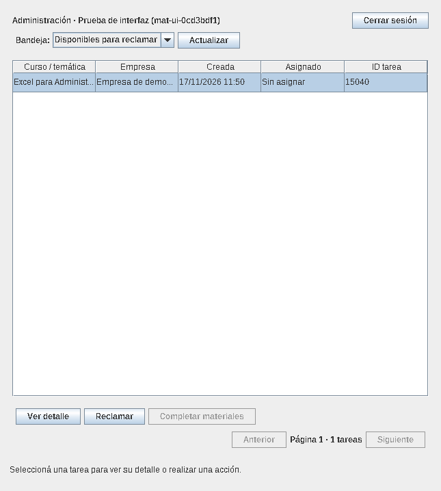

# App Java de materiales: ejecutar, usar y probar

Implementación del 17/11/2026. Corresponde a **§4.2.1** de la consigna y al bloque
**§7.1** del archivo de etapas. Su desarrollo M0–M6 es independiente de las etapas
9–11 del backend. Código en `app-materiales/`, paquete `ar.edu.cursos.materiales`.

## Inicio rápido

Requisitos: **JDK 21**, Maven y entorno gráfico de escritorio. Para ejecutar el
JAR ya compilado alcanza un runtime Java 21 con soporte de escritorio. La primera
compilación descarga dependencias desde Maven Central.

Desde la raíz del repositorio:

```bash
docker compose up -d
mvn -f app-materiales/pom.xml compile
./app-materiales/target/app-materiales
```

En Linux, `compile` genera el ejecutable `app-materiales/target/app-materiales`
y el acceso directo `app-materiales/target/Materiales.desktop`, que podés abrir con
doble clic. Si tu administrador de archivos lo pide, habilitá «Permitir ejecutar».
Necesitan Java 21 y las dependencias locales de Maven. El lanzador ubica el `.env`
desde la raíz del repositorio, independientemente de dónde lo abras. Si movés el
repositorio, recompilá para actualizar la ruta del acceso directo.

Para generar además un único JAR con sus dependencias
(`app-materiales/target/app-materiales.jar`), ejecutá
`mvn -f app-materiales/pom.xml clean verify`.
`clean verify` corre **6 pruebas rápidas**, sin conectarse a Docker. Hay otras
**2 pruebas de integración opcionales**, explicadas más abajo; aparecen omitidas
si no se habilitan. No hace falta correr una batería grande para usar esta app.

Alternativamente, después de compilar:

```bash
./app-materiales/ejecutar.sh
```

La app es de escritorio: se ejecuta en tu máquina, no dentro del contenedor del
backend. Para conectarse solo necesita PostgreSQL; para el funcionamiento completo
del proceso conviene mantener Flowable UI iniciado, ya que ejecuta timers y jobs.
No necesita que el backend REST o la web estén iniciados para listar/reclamar/completar.

## Configuración y credenciales

Por defecto lee `.env` desde el directorio de ejecución o `../.env`. Con los
comandos anteriores usa el archivo de la raíz del proyecto. No modifica ese archivo.

| Variable | Uso / valor predeterminado |
|---|---|
| `FLOWABLE_JDBC_URL` | `jdbc:postgresql://127.0.0.1:5433/` seguido de `POSTGRES_DB` (o `flowable`) |
| `FLOWABLE_JDBC_USER` | Si no está, toma `POSTGRES_USER` |
| `FLOWABLE_JDBC_PASSWORD` | Si no está, toma `POSTGRES_PASSWORD` |
| `FLOWABLE_PROCESO_CLAVE` | `process` |
| `FLOWABLE_TAREA_MATERIALES` | `preparar_materiales` |
| `GRUPO_ADMINISTRACION` | `Equipo-Administrativo` |

La URL debe apuntar a la **base del motor Flowable**, no a `institucion`. En este
Compose, desde el host se usa `127.0.0.1:5433`; desde otra máquina debe usarse el
host/puerto accesible de esa instalación. La publicación actual es solo loopback;
no se modificó la exposición de PostgreSQL para acceso remoto.

Para tener configuración independiente, copiar la plantilla y ajustar los valores:

```bash
cp app-materiales/materiales.env.example app-materiales/materiales.env.local
java -jar app-materiales/target/app-materiales.jar --config app-materiales/materiales.env.local
```

Orden de prioridad: archivo pasado con `--config` > variables de entorno > `.env`.
Los archivos admiten `CLAVE=valor`, comentarios en líneas que comienzan con `#`,
`export CLAVE=valor` y valores entre comillas simples o dobles. No ejecutan shell,
no interpolan `${VARIABLE}` y no interpretan escapes: escribir los valores finales.
`*.local` está ignorado por Git. La plantilla contiene una clave ficticia que debe
reemplazarse. No poner credenciales reales en la documentación ni en el repositorio.

Hay **dos credenciales diferentes**:

- La conexión JDBC usa usuario/contraseña de PostgreSQL desde la configuración.
- La ventana pide el usuario/contraseña del administrativo de **Flowable IDM**.

Los usuarios habituales son `Jefe-Administrativo` y `empleado-administrativo`.
El script IDM utiliza `1234` como clave de desarrollo al crear usuarios, salvo que
se haya configurado otra; no cambia usuarios existentes. Los docentes no pueden
ingresar a esta app, aunque tengan una contraseña válida en Flowable.

## Uso de las pantallas

1. Ingresar con un administrativo. La conexión y el login se hacen en segundo plano.
2. En **Disponibles para reclamar** aparecen únicamente tareas libres de materiales
   candidatas al grupo administrativo del proceso configurado.
3. Seleccionar una tarea y usar **Ver detalle**: temática, empresa, descripción,
   cursoId, processInstanceId, taskId y asignado. Los campos que no existan en
   variables del proceso quedan vacíos; no se consulta la BD institucional.
4. Usar **Reclamar** y confirmar. La tarea pasa a **Asignadas** del usuario que ganó
   el reclamo. Si otra persona la tomó primero se informa el conflicto.
5. Preparar los materiales fuera del programa. En **Asignadas**, seleccionar la
   tarea y usar **Completar materiales**, confirmando que el trabajo está hecho.
   Esto completa la tarea en Flowable y hace avanzar su rama del proceso.
6. **Actualizar** vuelve a consultar el motor. Las páginas tienen 20 tareas; los
   botones Anterior/Siguiente permiten recorrerlas. La tabla se puede ordenar.
7. **Cerrar sesión** limpia la sesión y la tabla. Cerrar la ventana cierra también
   el contexto del motor y sus conexiones. Mientras una operación está en curso,
   se espera su resultado antes de cerrar o lanzar otra.

Captura de la bandeja con datos ficticios de la comprobación gráfica (el fixture ya fue eliminado):



Una bandeja vacía puede ser correcta: la instancia debe haber llegado a
`preparar_materiales`. Publicar el proceso no crea tareas por sí solo. Las instancias
anteriores conservan su versión de definición. No se crean solicitudes desde esta app.

La aplicación no exige archivos adjuntos ni una descripción adicional de materiales:
la consigna requiere identificar, listar, reclamar y completar.

## Cómo funciona por dentro

```text
Swing → MaterialesService → servicios Java de Flowable → PostgreSQL compartido
                              IdentityService / TaskService / RuntimeService
```

`Motor` crea un contexto Flowable **6.8.0** contra el esquema existente, con
`databaseSchemaUpdate=false`, ejecutor asíncrono local desactivado y pool pequeño.
No usa H2, no crea otra base ni redespliega BPMN. Se incluye configurador DMN y
Groovy JSR-223: completar la última rama puede ejecutar scripts de confirmación
en la propia JVM de la app. Se agregan límites de conexión de 5 s y lectura de
20 s al driver PostgreSQL.

`MaterialesService` valida identidad por `IdentityService.checkPassword`, exige
membresía administrativa en cada operación y consulta únicamente tareas activas
del proceso y tipo configurados. Reclamo y completado reconsultan la tarea dentro
del comando/transacción del motor: candidatura y ausencia de asignado para
reclamar; asignación al usuario actual para completar. No usa `setAssignee`, no
acepta un usuario arbitrario desde la interfaz ni envía variables de proceso al
completar. Se establece y limpia el contexto de usuario del hilo de ejecución.
Los botones son una ayuda; las restricciones se comprueban también en el servicio.

Todas las operaciones de motor usan `SwingWorker`, evitando bloquear la ventana.
La contraseña del login se borra del campo al enviarse y se limpia el arreglo de
caracteres al terminar. La API requiere temporalmente un `String`; no se guarda
la contraseña en la sesión ni se imprime desde el código de la app.

| Archivo | Responsabilidad |
|---|---|
| `Main.java` | Inicio gráfico o diagnóstico de lectura |
| `Configuracion.java` | Carga de configuración y validación PostgreSQL |
| `Motor.java` | Contexto Flowable, DMN, conexiones y cierre |
| `MaterialesService.java` | Login, filtros y permisos para consultar/reclamar/completar |
| `Ventana.java` | Login, bandejas, detalle y acciones en segundo plano |
| `Usuario.java`, `Material.java` | Datos de sesión y filas/detalles |
| `ErrorAplicacion.java` | Mensajes para conflictos, tareas inexistentes y fallas de conexión |

Si el equipo agrega delegates/listeners Java, sus clases y dependencias deberán
estar **también en la app** cuando puedan ejecutarse tras completar materiales.
Para incorporar un JAR compartido sin recompilar la app, se puede iniciar con un
classpath explícito, por ejemplo en Linux:

```bash
java -cp 'app-materiales/target/app-materiales.jar:app-materiales/extensiones/*' ar.edu.cursos.materiales.Main
```

En Windows el separador del classpath es `;`. El modelo actual fue probado con
Groovy y DMN incluidos. No se modificó el BPMN para introducir saltos asíncronos.

## Pruebas mínimas

### Las de todos los días: 6 pruebas sin Docker

Desde la raíz:

```bash
mvn -f app-materiales/pom.xml test
```

Comprueban configuración, identidad y grupo, limpieza de contraseña, filtros de
bandeja, reclamo permitido/denegado, completado propio frente a ajeno/sin reclamo,
logout y limpieza del contexto de usuario incluso ante fallas. Usan mocks del
motor; no crean ni alteran cursos reales.

### Una vez al integrar: 2 pruebas adicionales contra tu motor

Con PostgreSQL y Flowable configurados y el proceso publicado:

```bash
mvn -f app-materiales/pom.xml verify -Dmateriales.integracion=true
```

Se ejecutan **8 pruebas en total**, no cientos:

- `IntegracionTest`: crea un proceso ficticio con ramas paralelas y una tarea de
  materiales, usuarios/grupo temporales y comprueba login, rechazo de docente y
  clave incorrecta, filtros, dos reclamos simultáneos (un solo ganador), rechazo
  de completado ajeno/de otra tarea, cancelación y ejecución de Groovy cuando se
  une la última rama. Borra únicamente sus fixtures al terminar.
- `ProcesoPublicadoTest`: crea una instancia ficticia de la definición publicada
  `process`, la posiciona en `preparar_curso` mediante la API del motor para preparar
  el escenario y reclama/completa materiales por el servicio de la app. Comprueba
  que desaparezca esa tarea y que las otras ramas sigan activas. Limpia su instancia,
  historial y usuario temporal. No altera el modelo ni toca instancias previas.

La segunda prueba supone los IDs actuales `registrar_elaborar_propuesta` y
`preparar_curso`; si el equipo cambia el contrato, actualizar esa preparación.
El escenario omite negociación/habilitación: **no certifica el curso completo**.
Ejecutar las integraciones en el entorno local/de pruebas del equipo. No necesitan
backend REST, contraseñas de administrativos existentes ni Postman. No despliegan
una nueva versión del proceso `process`; solo el primer test crea una definición
con clave temporal única. Si se interrumpe abruptamente la JVM, revisar fixtures
identificados con `mat-test-`, `mat_test_`, `mat-real-` o `TEST app-materiales` antes
de preparar una defensa.

### Comprobar conexión sin abrir ventanas

```bash
java -jar app-materiales/target/app-materiales.jar --diagnostico
```

Muestra la definición más reciente y hasta 20 IDs de tareas activas del proceso,
para contrastarlos con Flowable UI/REST. Es de lectura: no inicia instancias ni
reclama/completa tareas. Este modo usa credenciales JDBC, no sustituye el login
de la app. Puede ejecutarse en una terminal sin entorno gráfico.

### Comprobación manual breve

Con una instancia ficticia en preparación: ingresar como administrativo, reclamar
materiales, comprobar el mismo taskId en Flowable UI, completar y actualizar.
Con el otro administrativo verificar que ya no está disponible; con un docente
comprobar que se rechaza el ingreso. Con eso alcanza como prueba cotidiana de UI.
No hace falta repetir la suite integrada ante cambios solo de texto o disposición.

## Errores habituales

| Síntoma | Qué comprobar |
|---|---|
| No hay tareas | Versión de proceso, fase actual, usuario, bandeja y `preparar_materiales` |
| Usuario o contraseña incorrectos | Credencial de Flowable IDM, distinta de PostgreSQL/pgAdmin |
| Usuario sin permiso | Pertenencia a `Equipo-Administrativo` |
| Conexión rechazada | PostgreSQL iniciado y host/puerto JDBC; en esta máquina es 5433 |
| Autenticación JDBC fallida | Contraseña vigente de la base existente, no solo el valor de inicialización de Compose |
| Error de esquema | Misma versión Flowable 6.8.0 y base del motor correcta; la app no migra el esquema |
| Tarea cambió/desapareció | Otra persona la reclamó/completó o el proceso se canceló; actualizar |
| Error al completar | Actualizar antes de reintentar; revisar variables BPMN, Groovy, listeners/delegates y sus dependencias |
| Sin entorno gráfico | Ejecutar en sesión de escritorio; `--diagnostico` sirve en consola |

Ante fallo de conexión o respuesta incierta, el programa no anuncia éxito. Primero
usar Actualizar y comprobar si la tarea sigue activa/asignada; no repetir comandos
a ciegas. Si la operación ocurrió pero falló el refresco, ese estado aparece al
consultar de nuevo. Los cambios de backend Docker previos son independientes de
este módulo.

## Verificación realizada

El 17/11/2026, con Java 21 y PostgreSQL 15 del proyecto:

- JAR ejecutable compilado con dependencias, consulta real por Java a
  `process:4:51c6f829-e293-11f1-a462-721b934a1603` y lectura del mismo taskId
  observado previamente por REST.
- **8 pruebas aprobadas, 0 fallas, 0 errores**, incluidas ambas integraciones.
- Comprobación gráfica en escritorio: login con identidad temporal real, carga de
  bandeja y logout; capturas revisadas visualmente.
- Fixtures de pruebas eliminados, sin cambiar usuarios de negocio, modelos ni
  instancias preexistentes. Validación del ejecutable en otra máquina y la defensa
  del equipo siguen siendo una comprobación manual posterior.
