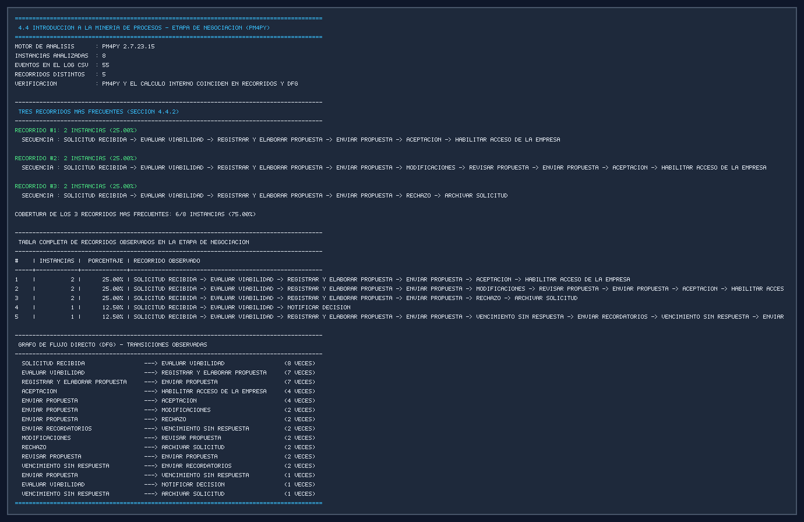

# Sección 4.4 — Introducción a la Minería de Procesos (PM4Py)

Análisis de minería de procesos sobre las ejecuciones históricas de la **etapa de negociación** del proceso de organización de cursos de capacitación (`process`), correspondiente al tramo previo al subproceso *Preparar curso* (`preparar_curso`).

---

## 1. Archivos entregados en esta carpeta

| Archivo | Descripción |
|---|---|
| [`exportar_history.py`](./exportar_history.py) | Script que consulta la API REST histórica de Flowable (`/history/historic-activity-instances`), filtra las actividades de la etapa de negociación y genera el archivo CSV. Ya no inventa datos de respaldo: si no puede leer Flowable o no hay instancias terminadas, termina con error. Con `--ejemplo` genera datos de prueba marcados como tales (`ejemplo-XXX`). |
| [`analizar.py`](./analizar.py) | Script de análisis con **PM4Py** (`pm4py.format_dataframe`, `pm4py.discover_dfg`, `pm4py.get_variants_as_tuples`, `pm4py.save_vis_dfg`, `pm4py.discover_bpmn_inductive`, `pm4py.write_bpmn`, `pm4py.save_vis_bpmn`) y verificación cruzada contra el cálculo interno que identifica los **3 recorridos más frecuentes** (cantidad y porcentaje) y genera las representaciones gráficas y el modelo BPMN descubierto. |
| [`negociacion_history.csv`](./negociacion_history.csv) | Archivo CSV exportado desde el historial real de Flowable (55 eventos correspondientes a 8 instancias con negociación terminada). |
| [`comportamiento_negociacion.png`](./comportamiento_negociacion.png) | Representación gráfica del comportamiento observado (Grafo de Flujo Directo / DFG con frecuencias de actividades y transiciones). |
| [`comportamiento_negociacion.svg`](./comportamiento_negociacion.svg) | Representación gráfica vectorial (SVG) del comportamiento observado. |
| [`modelo_descubierto.bpmn`](./modelo_descubierto.bpmn) | Modelo BPMN descubierto automáticamente a partir del log mediante *Inductive Miner* (`pm4py.discover_bpmn_inductive`). |
| [`modelo_descubierto.png`](./modelo_descubierto.png) | Representación PNG del modelo BPMN descubierto (generada cuando Graphviz `dot` está disponible en el entorno). |
| [`captura_resultados.png`](./captura_resultados.png) | Captura visual de la salida por consola con los 3 recorridos más frecuentes, porcentajes y transiciones del DFG. |
| [`resultados_analisis.txt`](./resultados_analisis.txt) | Salida completa en texto plano del análisis ejecutado. |

---

## 2. Instrucciones para reproducir el análisis

### Preparación del entorno (según §4.4 de la consigna)

```bash
sudo apt install python3-venv graphviz
python3 -m venv .venv
source .venv/bin/activate
pip install pm4py pandas requests
```

### Paso 1: Generar el archivo CSV desde Flowable (o con el lote de prueba)

Con Flowable corriendo en `http://localhost:8080/flowable-ui` y el `.env` en la raíz del repositorio:

```bash
python3 mineria-procesos/exportar_history.py
```

**Cómo se arma el log:**
- Un caso por instancia del proceso (`processInstanceId`).
- Solo se incluyen instancias con la negociación terminada (**aceptada**, **rechazada**, cerrada **sin respuesta** o **no viable**); las instancias en curso, borradas a mitad de camino o eliminadas administrativamente (`deleteReason`) se descartan.
- Del *Event-Based Gateway* (`gw_esperar_respuesta`), solo se exporta el evento que realmente ocurrió (reconocido por su actividad sucesora en el modelo), filtrando los eventos hermanos cancelados.
- Los vencimientos del temporizador de 5 días aparecen registrados como `Vencimiento sin respuesta`.
- Los `timestamp` son estrictamente crecientes (ordenados por milisegundo y orden lógico de desempate).

> **Nota:** los números dependen del historial acumulado en la base de cada máquina, así que es normal que cada integrante del equipo obtenga cantidades distintas. Si no se puede consultar Flowable o no hay negociaciones terminadas, el script termina con error sin sobrescribir el CSV.

Si se desea generar un dataset de prueba (marcado como `ejemplo-XXX`) sin requerir el contenedor de Flowable activo:

```bash
python3 mineria-procesos/exportar_history.py --ejemplo
```

### Paso 2: Ejecutar el análisis y generar las gráficas

```bash
python3 mineria-procesos/analizar.py
```

Con `pm4py` instalado en el entorno, el reporte (recorridos y grafo DFG) se calcula directamente con **PM4Py** y se verifica contra el cálculo interno integrado, dejando constancia en la línea `Verificación`. Además se descubre el modelo BPMN con `pm4py.discover_bpmn_inductive` (`modelo_descubierto.bpmn`). Si Graphviz (`dot`) está disponible, `pm4py.save_vis_dfg` y `pm4py.save_vis_bpmn` generan los PNG directamente; de lo contrario se usa el renderizador PNG integrado para el DFG.

---

## 3. Resultados obtenidos (Sección 4.4.2)

Sobre un total de **8 instancias** con negociación terminada (55 eventos registrados en [`negociacion_history.csv`](./negociacion_history.csv), descartando las 2 instancias activas en curso), se observaron **5 recorridos diferentes** en la etapa de negociación (análisis ejecutado con **PM4Py 2.7.23.15** y verificación coincidente contra el cálculo interno).

### Los 3 recorridos más frecuentes

| Puesto | Instancias | Porcentaje | Secuencia de actividades observada | Significado de negocio |
|---|---:|---:|---|---|
| **#1** | **2** | **25.00%** | `Solicitud recibida` → `Evaluar viabilidad` → `Registrar y elaborar propuesta` → `Enviar propuesta` → `Aceptacion` → `Habilitar acceso de la empresa` | Solicitud viable cuya primera versión de propuesta (`v1`) es aceptada directamente por la empresa. |
| **#2** | **2** | **25.00%** | `Solicitud recibida` → `Evaluar viabilidad` → `Registrar y elaborar propuesta` → `Enviar propuesta` → `Modificaciones` → `Revisar propuesta` → `Enviar propuesta` → `Aceptacion` → `Habilitar acceso de la empresa` | Solicitud viable donde la empresa pide modificaciones a la `v1`, el Jefe Administrativo revisa y envía una `v2`, y la empresa acepta. |
| **#3** | **2** | **25.00%** | `Solicitud recibida` → `Evaluar viabilidad` → `Registrar y elaborar propuesta` → `Enviar propuesta` → `Rechazo` → `Archivar solicitud` | Solicitud viable cuya propuesta es rechazada por la empresa y archivada por el Jefe Administrativo. |

> **Cobertura acumulada del Top 3:** **6 de 8 instancias (75.00%)**.

### Tabla completa de recorridos observados

| # | Instancias | Porcentaje | Recorrido completo |
|---|---:|---:|---|
| 1 | 2 | 25.00% | `Solicitud recibida` → `Evaluar viabilidad` → `Registrar y elaborar propuesta` → `Enviar propuesta` → `Aceptacion` → `Habilitar acceso de la empresa` |
| 2 | 2 | 25.00% | `Solicitud recibida` → `Evaluar viabilidad` → `Registrar y elaborar propuesta` → `Enviar propuesta` → `Modificaciones` → `Revisar propuesta` → `Enviar propuesta` → `Aceptacion` → `Habilitar acceso de la empresa` |
| 3 | 2 | 25.00% | `Solicitud recibida` → `Evaluar viabilidad` → `Registrar y elaborar propuesta` → `Enviar propuesta` → `Rechazo` → `Archivar solicitud` |
| 4 | 1 | 12.50% | `Solicitud recibida` → `Evaluar viabilidad` → `Notificar decision` |
| 5 | 1 | 12.50% | `Solicitud recibida` → `Evaluar viabilidad` → `Registrar y elaborar propuesta` → `Enviar propuesta` → `Vencimiento sin respuesta` → `Enviar recordatorios` → `Vencimiento sin respuesta` → `Enviar recordatorios` → `Vencimiento sin respuesta` → `Archivar solicitud` |

### Representación gráfica del comportamiento observado (DFG) y modelo BPMN descubierto


- Modelo BPMN descubierto automáticamente con *Inductive Miner*: [`modelo_descubierto.bpmn`](./modelo_descubierto.bpmn) *(el archivo `modelo_descubierto.png` se genera adicionalmente cuando Graphviz `dot` está instalado en el sistema)*.

### Captura de resultados del análisis



---

## 4. Comparación con el modelo BPMN y conclusión (Sección 4.4.3)

Al contrastar el grafo de comportamiento descubierto a partir del log de eventos (`negociacion_history.csv`) con la etapa de negociación diseñada en el modelo BPMN ([`institucion-de-capacitacion.bpmn20.xml`](../motor-flowable/modelos/institucion-de-capacitacion.bpmn20.xml)), se desprenden las siguientes conclusiones:

### 4.1 Coincidencias
1. **Secuencia inicial invariante:** El 100% de las instancias (8/8) inicia exactamente con el par `Solicitud recibida` → `Evaluar viabilidad`, respetando el evento de inicio y la *Decision Task* DMN (`reglaViabilidad`).
2. **Bifurcación por viabilidad:** El grafo refleja fielmente la separación inmediata tras `Evaluar viabilidad` entre las solicitudes no viables (`Notificar decision`, 1 caso, que finaliza sin pasar a propuesta) y las solicitudes viables (`Registrar y elaborar propuesta` → `Enviar propuesta`, 7 casos).
3. **Espera basada en eventos y desenlaces de negociación:** Desde `Enviar propuesta` (ejecutada 9 veces en total: 7 envíos iniciales + 2 reenvíos tras revisión) parten únicamente las cuatro ramas previstas por el *Event-Based Gateway* (`gw_esperar_respuesta`): `Aceptacion` (4), `Modificaciones` (2), `Rechazo` (2) y el evento de temporizador `Vencimiento sin respuesta` (1 primer vencimiento, además de 2 vencimientos posteriores luego de cada recordatorio).
4. **Caminos de cierre de la etapa:** Toda aceptación conduce exclusivamente a `Habilitar acceso de la empresa` (4/4) antes de ingresar a la preparación del curso, mientras que tanto el rechazo (2) como el tercer `Vencimiento sin respuesta` tras agotar los dos recordatorios (1) convergen en `Archivar solicitud` (3 casos en total).

### 4.2 Diferencias entre el comportamiento descubierto y el diagrama BPMN
1. **Abstracción de compuertas (Gateways):** En el diagrama BPMN existen las compuertas explícitas `gw_es_viable`, `gw_esperar_respuesta` y `gw_recordatorios`. En el grafo de flujo directo (DFG) orientado a actividades y eventos de negocio, estas decisiones se observan como bifurcaciones directas desde `Evaluar viabilidad`, `Enviar propuesta` y `Vencimiento sin respuesta`.
2. **Representación de los bucles:**
   - En el BPMN, `gw_recordatorios` vuelve a `gw_esperar_respuesta` tras enviar cada recordatorio e incrementar `recordatorios`, y pasa a `Archivar solicitud` cuando `recordatorios >= 2`. En el DFG descubierto, esto se visualiza como el ciclo **`Vencimiento sin respuesta` ⇄ `Enviar recordatorios`** (2 iteraciones en cada sentido), seguido de la transición `Vencimiento sin respuesta` → `Archivar solicitud` al tercer vencimiento.
   - De forma análoga, el ciclo `Enviar propuesta` → `Modificaciones` → `Revisar propuesta` → `Enviar propuesta` aparece como un ciclo cerrado entre esas tres actividades.

### 4.3 Limitaciones del análisis de minería de procesos
1. **Invisibilidad de las reglas de datos y guardas (perspectiva de control de flujo vs. perspectiva de datos):** El algoritmo de descubrimiento basado en trazas de eventos (`case_id`, `activity`, `timestamp`) descubre *qué* caminos se tomaron y con qué frecuencia, pero no descubre por sí solo *por qué* se tomó cada rama (por ejemplo, que `Notificar decision` depende de la regla DMN `cantCursos >= 5`, o que el bucle de `Enviar recordatorios` está acotado estructuralmente por la guarda `recordatorios >= 2` y que el contador se reinicia a `0` en cada `Enviar propuesta`).
2. **Sobregeneralización en bucles:** Al observar el ciclo `Vencimiento sin respuesta` ⇄ `Enviar recordatorios` en el DFG, un modelo descubierto sin perspectiva de datos podría inferir que se permiten 0, 1 o $N$ ciclos de recordatorios antes de archivar, cuando el proceso real fuerza exactamente dos recordatorios (tres vencimientos) antes de habilitar el paso a `Archivar solicitud`.
3. **Dependencia de la completitud del log:** La minería de procesos solo puede reflejar comportamientos que hayan ocurrido al menos una vez en el historial exportado. Si una combinación válida del BPMN (por ejemplo, una empresa que recibe un primer recordatorio, luego solicita modificaciones o acepta después de un recordatorio) no ocurrió todavía en el período exportado, esa transición (`Enviar recordatorios` → `Modificaciones` o `Enviar recordatorios` → `Aceptacion`) no aparecerá en el grafo descubierto aunque esté permitida en el modelo BPMN.
