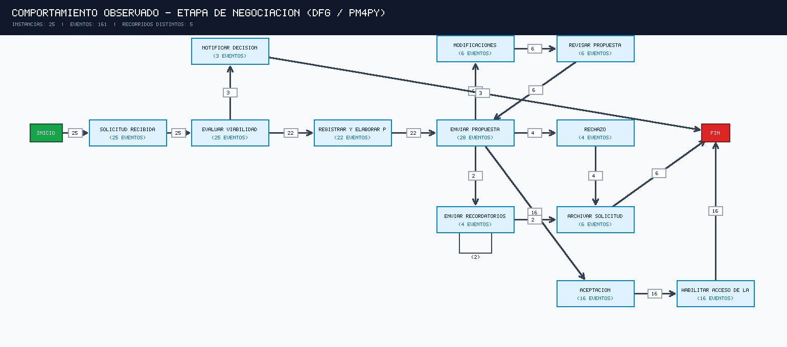

# Sección 4.4 — Introducción a la Minería de Procesos (PM4Py)

Análisis de minería de procesos sobre las ejecuciones históricas de la **etapa de negociación** del proceso de organización de cursos de capacitación (`process`), correspondiente al tramo previo al subproceso *Preparar curso* (`preparar_curso`).

---

## 1. Archivos entregados en esta carpeta

| Archivo | Descripción |
|---|---|
| [`exportar_history.py`](./exportar_history.py) | Script que consulta la API REST histórica de Flowable (`/history/historic-activity-instances`), filtra las actividades de la etapa de negociación del proceso implementado y genera el archivo CSV. También soporta `--ejemplo` para regenerar el lote de 25 ejecuciones históricas representativas. |
| [`analizar.py`](./analizar.py) | Script de análisis con **PM4Py** (`pm4py.format_dataframe`, `pm4py.discover_dfg`, `pm4py.get_variants_as_tuples`, `pm4py.save_vis_dfg`) y motor de respaldo integrado que identifica los **3 recorridos más frecuentes** (cantidad y porcentaje) y genera las representaciones gráficas. |
| [`negociacion_history.csv`](./negociacion_history.csv) | Archivo CSV utilizado en el análisis (161 eventos correspondientes a 25 instancias del proceso en la etapa de negociación). |
| [`comportamiento_negociacion.png`](./comportamiento_negociacion.png) | Representación gráfica del comportamiento observado (Grafo de Flujo Directo / DFG con frecuencias de actividades y transiciones). |
| [`comportamiento_negociacion.svg`](./comportamiento_negociacion.svg) | Representación gráfica vectorial (SVG) del comportamiento observado. |
| [`captura_resultados.png`](./captura_resultados.png) | Captura visual de la salida por consola con los 3 recorridos más frecuentes, porcentajes y transiciones del DFG. |
| [`resultados_analisis.txt`](./resultados_analisis.txt) | Salida completa en texto plano del análisis ejecutado. |

---

## 2. Instrucciones para reproducir el análisis

### Preparación del entorno (según §4.4 de la consigna)

```bash
sudo apt install python3-venv graphviz
python3 -m venv .venv
source .venv/bin/activate
pip install pm4py pandas requests
```

### Paso 1: Generar el archivo CSV desde Flowable (o con el lote de referencia)

Con Flowable corriendo en `http://localhost:8080/flowable-ui` y el `.env` en la raíz del repositorio:

```bash
python3 mineria-procesos/exportar_history.py
```

Si se desea regenerar exactamente el dataset histórico de referencia de 25 instancias sin requerir el contenedor de Flowable activo:

```bash
python3 mineria-procesos/exportar_history.py --ejemplo
```

### Paso 2: Ejecutar el análisis y generar las gráficas

```bash
python3 mineria-procesos/analizar.py
```

---

## 3. Resultados obtenidos (Sección 4.4.2)

Sobre un total de **25 instancias** (161 eventos registrados en [`negociacion_history.csv`](./negociacion_history.csv)), se observaron **5 recorridos diferentes** en la etapa de negociación.

### Los 3 recorridos más frecuentes

| Puesto | Instancias | Porcentaje | Secuencia de actividades observada | Significado de negocio |
|---|---:|---:|---|---|
| **#1** | **10** | **40.00%** | `Solicitud recibida` → `Evaluar viabilidad` → `Registrar y elaborar propuesta` → `Enviar propuesta` → `Aceptacion` → `Habilitar acceso de la empresa` | Solicitud viable cuya primera versión de propuesta (`v1`) es aceptada directamente por la empresa. |
| **#2** | **6** | **24.00%** | `Solicitud recibida` → `Evaluar viabilidad` → `Registrar y elaborar propuesta` → `Enviar propuesta` → `Modificaciones` → `Revisar propuesta` → `Enviar propuesta` → `Aceptacion` → `Habilitar acceso de la empresa` | Solicitud viable donde la empresa pide modificaciones a la `v1`, el Jefe Administrativo revisa y envía una `v2`, y la empresa acepta. |
| **#3** | **4** | **16.00%** | `Solicitud recibida` → `Evaluar viabilidad` → `Registrar y elaborar propuesta` → `Enviar propuesta` → `Rechazo` → `Archivar solicitud` | Solicitud viable cuya propuesta es rechazada por la empresa y archivada por el Jefe Administrativo. |

> **Cobertura acumulada del Top 3:** **20 de 25 instancias (80.00%)**.

### Tabla completa de recorridos observados

| # | Instancias | Porcentaje | Recorrido completo |
|---|---:|---:|---|
| 1 | 10 | 40.00% | `Solicitud recibida` → `Evaluar viabilidad` → `Registrar y elaborar propuesta` → `Enviar propuesta` → `Aceptacion` → `Habilitar acceso de la empresa` |
| 2 | 6 | 24.00% | `Solicitud recibida` → `Evaluar viabilidad` → `Registrar y elaborar propuesta` → `Enviar propuesta` → `Modificaciones` → `Revisar propuesta` → `Enviar propuesta` → `Aceptacion` → `Habilitar acceso de la empresa` |
| 3 | 4 | 16.00% | `Solicitud recibida` → `Evaluar viabilidad` → `Registrar y elaborar propuesta` → `Enviar propuesta` → `Rechazo` → `Archivar solicitud` |
| 4 | 3 | 12.00% | `Solicitud recibida` → `Evaluar viabilidad` → `Notificar decision` |
| 5 | 2 | 8.00% | `Solicitud recibida` → `Evaluar viabilidad` → `Registrar y elaborar propuesta` → `Enviar propuesta` → `Enviar recordatorios` → `Enviar recordatorios` → `Archivar solicitud` |

### Representación gráfica del comportamiento observado (DFG)



### Captura de resultados del análisis


---

## 4. Comparación con el modelo BPMN y conclusión (Sección 4.4.3)

Al contrastar el grafo de comportamiento descubierto a partir del log de eventos (`negociacion_history.csv`) con la etapa de negociación diseñada en el modelo BPMN ([`institucion-de-capacitacion.bpmn20.xml`](../motor-flowable/modelos/institucion-de-capacitacion.bpmn20.xml)), se desprenden las siguientes conclusiones:

### 4.1 Coincidencias
1. **Secuencia inicial invariante:** El 100% de las instancias (25/25) inicia exactamente con el par `Solicitud recibida` → `Evaluar viabilidad`, respetando el evento de inicio y la *Decision Task* DMN (`reglaViabilidad`).
2. **Bifurcación por viabilidad:** El grafo refleja fielmente la separación inmediata tras `Evaluar viabilidad` entre las solicitudes no viables (`Notificar decision`, 3 casos, que finalizan sin pasar a propuesta) y las solicitudes viables (`Registrar y elaborar propuesta` → `Enviar propuesta`, 22 casos).
3. **Espera basada en eventos y desenlaces de negociación:** Desde `Enviar propuesta` (ejecutada 28 veces en total: 22 envíos iniciales + 6 reenvíos tras revisión) parten únicamente las cuatro ramas previstas por el *Event-Based Gateway* (`gw_esperar_respuesta`): `Aceptacion` (16), `Modificaciones` (6), `Rechazo` (4) y el vencimiento del plazo hacia `Enviar recordatorios` (2).
4. **Caminos de cierre de la etapa:** Toda aceptación conduce exclusivamente a `Habilitar acceso de la empresa` (16/16) antes de ingresar a la preparación del curso, mientras que tanto el rechazo (4) como el agotamiento de los dos recordatorios (2) convergen en `Archivar solicitud` (6 casos en total).

### 4.2 Diferencias entre el comportamiento descubierto y el diagrama BPMN
1. **Abstracción de compuertas (Gateways) y eventos de temporizador puros:** En el diagrama BPMN existen las compuertas explícitas `gw_es_viable`, `gw_esperar_respuesta` y `gw_recordatorios`, además del evento intermedio `evento-5-dias`. En el modelo de flujo directo (DFG) orientado a actividades de negocio, estas decisiones se observan como bifurcaciones directas desde `Evaluar viabilidad` y `Enviar propuesta`.
2. **Representación de los bucles:**
   - En el BPMN, el envío de recordatorios vuelve a `gw_esperar_respuesta` tras incrementar la variable `recordatorios` y solo pasa a `Archivar solicitud` cuando `recordatorios >= 2`. En el DFG descubierto, esto se visualiza como un **auto-bucle** sobre `Enviar recordatorios` (`Enviar recordatorios` → `Enviar recordatorios`) seguido de una transición hacia `Archivar solicitud`.
   - De forma análoga, el ciclo `Enviar propuesta` → `Modificaciones` → `Revisar propuesta` → `Enviar propuesta` aparece como un ciclo cerrado entre esas tres actividades.

### 4.3 Limitaciones del análisis de minería de procesos
1. **Invisibilidad de las reglas de datos y guardas (perspectiva de control de flujo vs. perspectiva de datos):** El algoritmo de descubrimiento basado en trazas de eventos (`case_id`, `activity`, `timestamp`) descubre *qué* caminos se tomaron y con qué frecuencia, pero no descubre por sí solo *por qué* se tomó cada rama (por ejemplo, que `Notificar decision` depende de la regla DMN `cantCursos >= 5`, o que el bucle de `Enviar recordatorios` está acotado estructuralmente por la guarda `recordatorios >= 2` y que el contador se reinicia a `0` en cada `Enviar propuesta`).
2. **Sobregeneralización en bucles:** Al observar el arco `Enviar recordatorios` → `Enviar recordatorios` en el DFG, un modelo descubierto sin perspectiva de datos podría inferir que se permiten 1, 3 o $N$ recordatorios consecutivos antes de archivar, cuando el proceso real fuerza exactamente dos recordatorios antes de habilitar el paso a `Archivar solicitud`.
3. **Dependencia de la completitud del log:** La minería de procesos solo puede reflejar comportamientos que hayan ocurrido al menos una vez en el historial exportado. Si una combinación válida del BPMN (por ejemplo, una empresa que recibe un primer recordatorio, luego solicita modificaciones, recibe un nuevo recordatorio y finalmente acepta) no ocurrió todavía en el período exportado, esa transición (`Enviar recordatorios` → `Modificaciones` o `Enviar recordatorios` → `Aceptacion`) no aparecerá en el grafo descubierto aunque esté permitida en el modelo BPMN.
